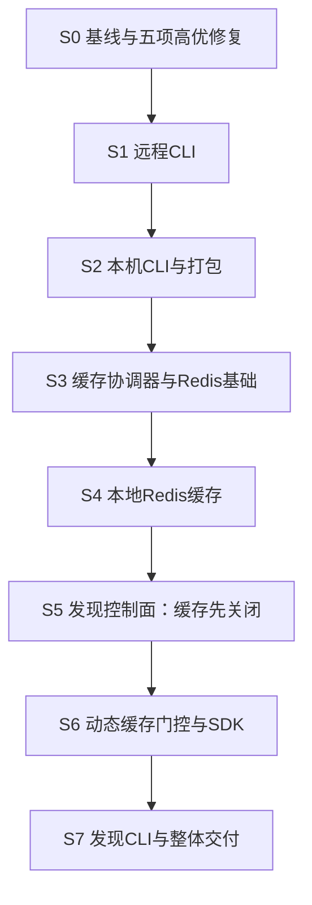

# 未完成方案实现顺序与对齐清单

> 日期：2026-10-11；修订：R4；核对基线：Git HEAD `6c554dd`。
> 状态：实施路线已重新对齐；S0 的五项高优修复和下列新增功能阶段均未执行。源码与提交记录用于判断已有能力，不替代本次运行验证。
> 用途：统一现有方案的先后、依赖和交叉契约；具体配置、命令、测试仍以对应专题文档为准。

## 1. 当前有哪些真正未完成的方案

当前新增功能主要有三项，但不能直接从功能方案开始。只读代码评审发现的五个高优先级问题必须先完成并取得回归证据；之后才按 **CLI → 节点本地 Redis 行缓存 → Redis 动态发现及其 CLI 扩展** 推进。

| 方案 | 当前状态与源码依据 | 本轮安排 |
|---|---|---|
| [cpl CLI](cpl-cli-design.md) | 设计完成；尚无cli.py、__main__.py、本机control-dir协议和Python打包元数据 | 先交付远程命令，再本地生命周期与安装包 |
| [节点本地 Redis 行缓存](redis-cache-design.md) | 设计完成；现有RowCache/CachingDatabase仍为内存实现，尚无Redis客户端/RowStore/恢复/自启能力 | 在静态集群上完成后端和故障行为，再接动态拓扑 |
| [Redis 动态服务发现](redis-discovery-design.md) | 设计完成并补充本轮对齐；现有配置、OwnershipRouter和SDK仍使用静态节点/HTTP seed | 最后增加注册租约、运行时视图、SDK provider和discovery命令 |

`docs/superpowers/` 中有部分旧文档仍标“待评审”“待实施”，或者任务未勾选，不能据此把所有内容重新列为未开发。

| 历史方案组 | 当前证据与处理 |
|---|---|
| [后端CRUD API](superpowers/specs/2026-08-06-cpp-crud-api-design.md)、[DB中间件](superpowers/specs/2026-08-06-db-middleware-design.md)、[三池加固](superpowers/specs/2026-08-06-pool-hardening-design.md)及其分期计划 | 当前已有通用CRUD、DataSourceRegistry、SQLite后端、NVI和三池实现/对应测试文件；作为已有底座，按当前API核验，不重新实现旧score API |
| [静态集群与内存缓存](superpowers/specs/2026-08-11-cluster-cache-design.md)及ownership/SDK/failover分期计划 | `eef0a5f`、`2c432b2`已交付核心模块；现有hash、owner/307、缓存和Python SDK作为回归基线 |
| [MySQL后端](superpowers/specs/2026-08-15-mysql-backend-design.md) | `c64f57c`已有实现，后续硬化提交也修改了MySQL；不作为全新后端项目。当前源码仍有需要ON构建确认的类型问题，归入S0 |
| [代码加固及六个子计划](superpowers/plans/2026-08-17-code-hardening-index.md) | `6d747f2`、`9d0d8a8`、`899e96e`、`e37bdca`、`6c554dd`对应阶段性实现；保留残余缺陷和未验证平台的核验，不从第一个任务全部重跑开发 |

历史“实现已落地”与“所有平台验收完成”是两件事。当前盘点只确认源码和提交存在；MySQL、Windows/macOS、sanitizer、真实Redis及e2e的通过情况，在实施时按实际环境留证据。

## 2. 推荐执行顺序

下表S编号是全局排期，CLI阶段0–5、缓存P0–P7、发现P0–P6保持各自原编号，避免三个“P1”混用。进度更新只记录真实产物/验收，不把文档评审通过计作功能完成。

| 全局阶段 | 对应原方案 | 具体交付 | 进入下一步的门槛 | 当前状态 |
|---|---|---|---|---|
| S0 基线与五项高优修复 | 历史加固残余项、缓存P0、HTTP生命周期Task 4 | 先完成基线证据和五个只读评审问题：MySQL ON 编译阻断、Singleflight 竞态、bypass 异常复位、Prometheus 重复声明、HTTP 慢速发送总期限 | 目标平台上的基线/定向测试真实运行；五项均有 RED→GREEN 证据；默认内存/静态集群契约不变 | 代码修复完成；MySQL真实账号验收待环境 |
| S1 远程CLI | CLI阶段0–2 | parser、严格JSON/输出/错误映射、health、四个CRUD，源码`python -m cpppools`入口 | 无网络help/version；远程命令复用SDK；成功写不因CLI重新执行；真实HTTP CRUD | 待执行 |
| S2 本机CLI与基础打包 | CLI阶段3–5 | POSIX/Windows控制、ready/stopped、start/stop/status、pyproject、cpl入口与包安装 | 目标平台真实进程控制；停止超时不假报成功；源码树外wheel/sdist可安装 | 待执行 |
| S3 共享缓存与Redis基础 | 缓存P1–P2、P3的transport子任务 | 稳定RowCache协调入口、flight_id/token/异常复位；配置/codec；唯一可选hiredis构建和私有有界transport | 原内存语义不变；flight身份竞态关闭；OFF无依赖、ON能链接；transport确实受总期限/响应大小限制 | 待执行 |
| S4 本地Redis缓存交付 | 缓存P3剩余部分、P4–P7 | 显式实例→故障冷内存→恢复资格/自启→静态集群验证；运维和性能证据 | SQL成功不因缓存故障变成重试；旧namespace不复活；专用实例归属、停止和支持平台明确 | 待执行 |
| S5 发现控制面与服务端 | 发现P0–P2 | discovery配置、共享状态/脚本、注册租约、runtime snapshot、HTTP诊断；先cache-off | 新ID可在固定fallback列表外加入；expired lease可重新登记；empty/outage/blocked区别正确；请求线程不访问发现Redis | 待执行 |
| S6 动态路由与SDK | 发现P3–P4 | topology gate与两种缓存后端集成、请求版本、hold-down、from_redis、schema快照、close | 旧请求不能回填；Fallback始终旁路；一次操作不混身份；blocked/close后不发新尝试；动态cold restart不暖复用 | 待执行 |
| S7 发现CLI与组合交付 | 发现P5–P6 | 复用基础CLI增加discovery诊断/管理及Pythonextra；完整增减节点/分区/恢复演练 | 管理结果不明可确认且不乱重发；两个Redis故障分别按各自策略处理；合并部署、回退和发布证据 | 待执行 |

这样排期的原因：五项高优问题属于已有实现的正确性/构建阻断，必须先清零，避免 CLI 和 Redis 验收把底层缺陷误判为新功能问题。CLI 可以随后使用现有 HTTP/SDK 交付；其生命周期和包入口再为新功能提供统一操作入口。缓存方案先把后端 token、Singleflight 和 Redis 通信边界稳定下来，动态发现再在同一套结构上增加拓扑门控，避免两份方案各自改写 RowCache。最后扩展已有 CLI，不再建立第二套命令、包或路由逻辑。

### 2.1 S0 内部执行顺序：五个优先问题

S0 不是一次性“全部修复”的大提交，而是按下面顺序拆成可独立验证的小任务。每个任务遵循 RED → 最小修复 → 定向测试 → 全量回归 → 评审 → 独立提交；若当前源码已经修复某项，仍须运行对应测试确认，不能只根据历史提交标记完成。

| 顺序 | 只读评审问题 | 主要文件/现有方案入口 | 必须先得到的证据 |
|---|---|---|---|
| S0.1 | MySQL ON 的 `ResultSet::columns` 类型编译阻断 | `src/db/mysql_database.cpp`；[缓存方案基线与 MySQL 门槛](redis-cache-design.md#2-当前代码基线与设计落点) | `CPPPOOLS_USE_MYSQL=ON` 配置、编译实际通过；缺依赖只能记录环境阻断，不能以 SKIP 代替 |
| S0.2 | Singleflight 在同分片其他 key 失效后可能遗留未兑现 promise | `src/db/row_cache.h`；[缓存 P1](redis-cache-design.md#p1抽出内存行存储与完整-token) | `shard_count=1`、barrier 控制的确定性测试：旧 leader/follower 均结束，旧 flight 被移除，新 flight 不被误完成 |
| S0.3 | bypass 状态只在正常返回路径复位，异常可能污染连接 | `src/db/caching_database.h`、`src/server/crud_api.cpp`；[缓存 P1](redis-cache-design.md#p1抽出内存行存储与完整-token) | DB 操作抛异常后连接归还；下一次请求不再 bypass；RAII/作用域清理测试通过 |
| S0.4 | `cpppools_cache_bypass_total` 重复输出 HELP/TYPE | `src/server/http_server.cpp`、`test/test_metrics.cpp`；[缓存 P7](redis-cache-design.md#p7集群观测性能与交付) | 解析 `/metrics` 确认每个指标族只有一条 HELP/TYPE；缓存启用和关闭两种路径都通过 |
| S0.5 | HTTP 发送仅依赖逐次 socket 超时，慢速不读客户端可能耗尽 worker | `src/server/http_server.cpp`、`test/test_http_server.cpp`；[HTTP 生命周期 Task 4](superpowers/plans/2026-08-17-http-lifecycle-portability.md#task-4-bound-sends-and-isolate-winsockposix-behavior) | 对端不读取的大响应在有限总期限内退出；POSIX/Windows 分支使用同一语义，不能用 sleep-only 测试代替 |

S0.1 是构建门槛；S0.2 与 S0.3 属于缓存正确性，建议连续完成；S0.4 必须在指标变更前清零；S0.5 独立于 Redis，但必须在 CLI 真实 HTTP 验收前完成。五项全部通过后，才进入 S1；任何一项未验证，只能停留在 S0，不能把后续专题标为“可验收”。

### 2.2 S0 实施证据（2026-10-11）

五项修复已按独立 RED→GREEN 提交完成：

| 阶段 | 提交 | 实际证据 | 状态 |
|---|---|---|---|
| S0.1 | `b4e893f` | MariaDB 客户端头/库临时隔离目录下，`CPPPOOLS_USE_MYSQL=ON` 构建、链接成功；ON CTest 20 个目标均登记并通过，两个 MySQL 集成用例因未设置 `CPPPOOLS_TEST_MYSQL_USER` 明确 SKIP | 代码通过；真实数据库验收待账号 |
| S0.2 | `ff1ebe4` | `test_other_key_invalidation_retires_old_flight` 先 RED 后 GREEN；OFF CTest 18/18、ON CTest 20/20 | 通过 |
| S0.3 | `44536b6` | 可控 throwing backend 先证明 bypass 泄漏，再用 RAII guard 修复；OFF/ON 全量回归通过 | 通过 |
| S0.4 | `07a3999` | 缓存启用的重复 HELP/TYPE 测试先 RED 后 GREEN；OFF/ON 全量回归通过 | 通过 |
| S0.5 | `b401ba1` | 非读端和每 50ms 读 1 字节端两类发送测试；非 HTTP 测试 17/17，`test_http_server` 独立运行退出码 0；ON 同样完成构建，HTTP 专项退出码 0 | 通过 |

S0 的剩余验收阻断只有真实 MySQL 服务账号：配置 `CPPPOOLS_TEST_MYSQL_HOST/PORT/USER/PASSWORD` 后，必须重新运行 `test_mysql_introspection` 和 `test_mysql_crud`，并把输出和退出码记录到阶段证据；在此之前不进入 S1。

## 3. 真正的依赖与可调整的先后

上述是降低返工的推荐顺序，不把工程偏好写成运行时强依赖。

| 工作 | 硬依赖 | 只是推荐在前 |
|---|---|---|
| 远程CLI | 已有SDK/API与 S0 全部高优修复通过 | 本地start/stop、Redis缓存、发现中心均不是前提 |
| 本地Redis缓存 | S0 通过、共享缓存协调器、可选客户端、真实DB/隔离缓存实例、可靠停机收尾 | CLI先完成方便验收；服务可直接启动，不要求先安装cpl |
| 发现控制面及服务端cache-off | S0 通过、有界Redis transport、协议/配置、现有HTTP服务 | 不要求本地缓存Redis可用，也不要求暖恢复/自启已完成 |
| 动态缓存门控 | 服务端runtime、统一token/fence/flight；使用Redis缓存时须有其冷切换/namespace协议 | 可先验证纯内存动态模式；本地Redis后端并不是发现服务的必需运行组件 |
| Redis SDK provider | 发现协议/HTTP契约、请求快照和生命周期 | 不依赖CLI本机管理；纯Redis冷启动仍需HTTPschema |
| discovery CLI | 基础CLI parser/输出、SDK provider、管理CAS/查询协议、已有pyproject | 不再重复基础CLI打包或Windows本机控制 |

如果业务更急需动态发现，可在S3完成之后先做S5的cache-off路径，再回S4；这是可行的调序，**不允许跳过S6缓存安全门槛就开放动态缓存**。当前没有需要变更推荐主线的明确要求，按S0→S7执行。

## 4. 三份方案必须共同遵守的对齐契约

### 4.1 两种Redis职责分开，客户端基础只实现一次

- **本地缓存Redis**：节点专用，保存可丢弃行缓存，可在已支持平台自启；故障一次性转冷内存，本进程不自动切回。
- **发现中心Redis**：共享、由部署方提供，只保存发现状态；短故障last_good，超过grace静态回退；同一权威恢复后可自动回动态。
- endpoint、凭据、连接/队列、目录、run_id和状态机各自独立。禁止共享缓存namespace与发现state，禁止把缓存launcher用于启动/关闭发现中心。
- 共用一个 `CPPPOOLS_USE_REDIS` 可选构建开关和一个私有 `src/redis/` transport。缓存P3首次需要网络时提取实际用到的deadline/RESP预算/TLS/RAII能力；db和server分别依赖该下层组件，db不依赖server。不提前创建无调用方的通用框架。
- OFF仍无Redis客户端依赖；cache.auto在OFF可以冷内存回退，discovery.enabled=true在OFF属于配置错误。两者不同的失败策略应同时覆盖。

### 4.2 RowCache、token和锁只维护一套

RowCache仍是每数据源共享协调器。缓存方案先落地 `(backend_epoch, datasource_namespace, shard_generation, flight_id)`；发现方案在同一token/context上加入 `topology_revision`，其值就是共享CacheAdmissionGate的admission_revision，不建立第二个同义计数器。不要建立第二套flight表，也不要把backend_epoch和拓扑epoch混成一个数字。清理、人工enable/disable、Rejoin和自动降级均经过同一套准入/退休入口；人工enable不能覆盖blocked、hold-down和租约失效。

发现方案的CacheAdmissionGate只保护本地短状态与memory操作，**不得持有它执行Redis GET/SET/DEL、等待lane、flight或DB**。Redis路径先捕获token，再在后端lane中执行有界操作，回复后复核准入才暴露命中/兑现等待者。拓扑clear对于memory清条目并退休flight，对于Redis只原子旋转namespace/退休token，旧在途SET落入旧空间；不在全局gate内扫描或删除整个Redis。保持现有I0：写前/后的失效针对当时的当前后端，SQL已成功不得因缓存回填/失效失败重发。

### 4.3 动态成员、静态兜底与schema

`cluster.node_id`始终表示本节点身份；`cluster.nodes`在discovery模式只是一份固定兜底列表，不是所有动态节点的白名单。启用discovery时允许self不在该列表，以支持fallback `{A,B}` 下新增C；关闭discovery时继续现有“self必须在nodes”校验。新节点配置相同fallback policy即可注册，不能为了加入C把所有节点的fallback列表改成 `{A,B,C}`。

同generation内schema冻结。节点上线前比较完整路由相关schema及真实DB目标；SDK bootstrap建立不可变schema，后续拓扑更新复用它，把schema引用与snapshot作为一个客户端状态提交，禁止先换环再保留旧schema。schema变更使用已有重启/新generation维护流程，不顺带增加热DDL。

所有会被Redis SDK使用的动态成员、静态fallback与cold-start seeds，都必须支持discovery v1的旁路协议。旧OFF owner会忽略Fallback，不能因新SDK发送一个头就宣称不缓存。首次迁移先关闭缓存，完成服务节点升级与discovery启用，再放行Redis SDK；SDK遇缺少v1 capability的目标不执行CRUD。legacy SDK访问新节点保留缺版本头的bypass兼容。

### 4.4 缓存恢复、TTL及停机

动态模式首版必须 `cache.warm_reuse=false`，配置true明确拒绝。动态集群可能有其他节点写库，不能因本节点正常stop就认定其持久行缓存可暖复用。单节点、无discovery且确有单写入者证明时，保留缓存方案已有显式warm能力。

节点应用有效cache默认值后校验I1；发现policy还必须满足 `blacklist_ttl_ms >= cache_ttl_ceiling_ms`，节点实际TTL不得超过ceiling，SDK采用中心blacklist。cache.auto的隐式推导不能覆盖明确中心policy，更不能忽略显式无效小值。

正常停止统一按一个main生命周期编排：关闭新缓存准入/HTTP接入 → drain并完成业务写/失效 → 按实际结果处理缓存恢复清单 → 有界fenced注销/停止发现agent → 关闭客户端、DB/池等资源 → 发布CLI stopped终态。每个资源只能有一个关闭方；CLI 5秒drain不是全进程退出证明。force/crash不得授予cache clean，注销失败依赖lease到期；CppPools退出不关闭独立缓存Redis，也不关闭发现中心。

### 4.5 HTTP、SDK和CLI契约

保持 `/health`纯文本、`/api/v1/cluster`原self/hash/ttl字段、64KiB请求体限制及既有X-CppPools-Epoch/Fallback/Rejoin头。新增discovery字段/头按专题契约实现；discovery 503不计作DB acquire timeout。

一次CRUD的owner/URL/identity取同一snapshot；每次真正发送（重试、redirect、换候选也算）前仍检查close/blocked/当前操作期限。失去资格则结束本次操作，下一次调用再捕获降级视图；已经送出的请求可完成，成功写照常返回，禁止因随后拓扑更新重发。

基础CLI只安装一个cpppools包和cpl入口；发现方案在同一pyproject增加可选 `[discovery]` extra及discovery子命令。`-u/--url`为seed主模式，与`--discovery-profile`互斥；discovery模式不自动注入CPL_URL。CRUD JSON沿用SDK结果，envelope仅用于discovery诊断命令，退出码11/12不能覆盖本地stop的7–10。

## 5. S0核验和公共任务归属

下列事项已经在专题文档出现，将它们归给首次修改该模块的阶段，不重复写两份补丁。这里不是宣称所有历史缺陷仍未修复；执行时先检查当前源码和已有测试，再决定是否需要变更。

| 项目 | 当前已见依据 | 首次归属及后续复用 |
|---|---|---|
| MySQL ON构建 | `mysql_database.cpp`的lock_rs.columns赋值与目标vector类型有不匹配迹象，需构建确认 | S0/缓存P0；声明MySQL支持的发布必须验证ON，缺环境不冒充通过，也不阻止只做CLI parser/OFF开发 |
| Singleflight身份及异常复位 | join和另取generation存在窗口，尚无flight_id；handler需要完整RAII复位 | S3/缓存P1统一修复；发现P3复用，不重新设计 |
| Redis构建及bounded transport | 当前CMake尚无Redis选项 | S3/缓存P2–P3；发现P1直接复用 |
| 本机进程身份/锁/终态 | 当前未实现CLI控制目录 | S2/CLI3–4；缓存launcher只在身份工具可复用时复用，实例状态和停止策略分开 |
| HTTP统计口径 | 缓存P7已列Prometheus重复声明；发现blocked新增503类别 | S4修缓存现有指标；S5再加发现分类；最终接口文档只维护一份 |
| Python包与资源 | 当前无pyproject；未来CLI先需要它 | S2/CLI5创建；S7只追加extra和脚本资源 |
| API/SDK文档 | 当前已有backend_api.md/sdk.md | 每功能阶段同步其增量；最终S7核对组合配置，不等到最后才补接口说明 |

实施记录建议每阶段一页证据：基线SHA、实际变更、关键用例及命令/退出码、非零tests数量、skip原因、review结论和遗留项。不要一次把旧加固计划未勾选项全部标完成；只更新有证据的状态。

## 6. 组合验收与回退顺序

各专题保留自己的测试矩阵，组合验收补以下交叉场景，不重复已有用例。

| 场景 | 必须得到的结果 |
|---|---|
| 静态集群+memory，两个Redis功能均关闭 | 与当前基线相同；CLI不用Redis包，服务无Redis连接 |
| 静态集群+本地Redis | 按缓存方案运行；发现中心不必存在 |
| 动态发现+memory | 按发现协议路由；本地缓存Redis不必存在 |
| 动态发现+本地Redis，只有缓存Redis故障 | 本节点转冷memory；发现仍redis source，provider不得跟着切静态 |
| 动态发现+本地Redis，只有发现中心故障 | last_good→static，缓存准入关闭；不把健康本地Redis误报为故障，不关闭该实例 |
| 动态发现恢复但本地缓存已冷切memory | 回动态并hold-down，继续memory；禁止借发现恢复重连缓存Redis |
| topology clear与旧Redis SET交错 | 新namespace不可读旧SET；所有waiter能结束，I0仍执行 |
| fallback `{A,B}` 下新增C | 无需改中心fallback或所有节点配置；C可注册，Redis失联时C不冒充静态owner |
| SDK退避时观察empty或close | 不再启动新HTTP尝试；已成功写只返回一次 |
| CLI stop/force与两个Redis功能组合 | 正常stop收尾完成后才写终态；force无暖资格；共享中心/独立缓存进程仍存在 |

回退按后加功能先撤：冻结流量并关闭缓存 → 撤Redis provider/discovery CLI使用、恢复静态服务配置 → 必要时将cache.backend改memory并废弃旧暖资格 → 再处理CLI版本。回退不是删除共享中心Key/停掉Redis进程的指令；无法核验的清理不作为正常步骤。

## 7. 本轮对齐结论

已将三份新方案作为实际待实现主线，历史已落地方案归入基线核验；统一了阶段编号引用、共享模块归属、两个Redis故障策略、token与namespace、schema、动态扩容、SDK发送门控、打包及停机。专题文档的方案入口均链接回本路线，历史加固索引注明当前执行入口。

本轮只编写和对齐文档，不运行产品测试、不创建实现模块；S0–S7全部保持“待执行”。在没有实现/平台证据之前，不给工期或完成百分比。

两位独立读者已复核实施顺序、控制面关键修订和跨方案契约，未发现影响实施的剩余依赖循环或路线冲突。文档核验覆盖本路线、三个专题和历史加固索引：相对文件链接可解析，Markdown围栏成对，现有JSON示例可解析；这不是产品测试或阶段完成证据。
