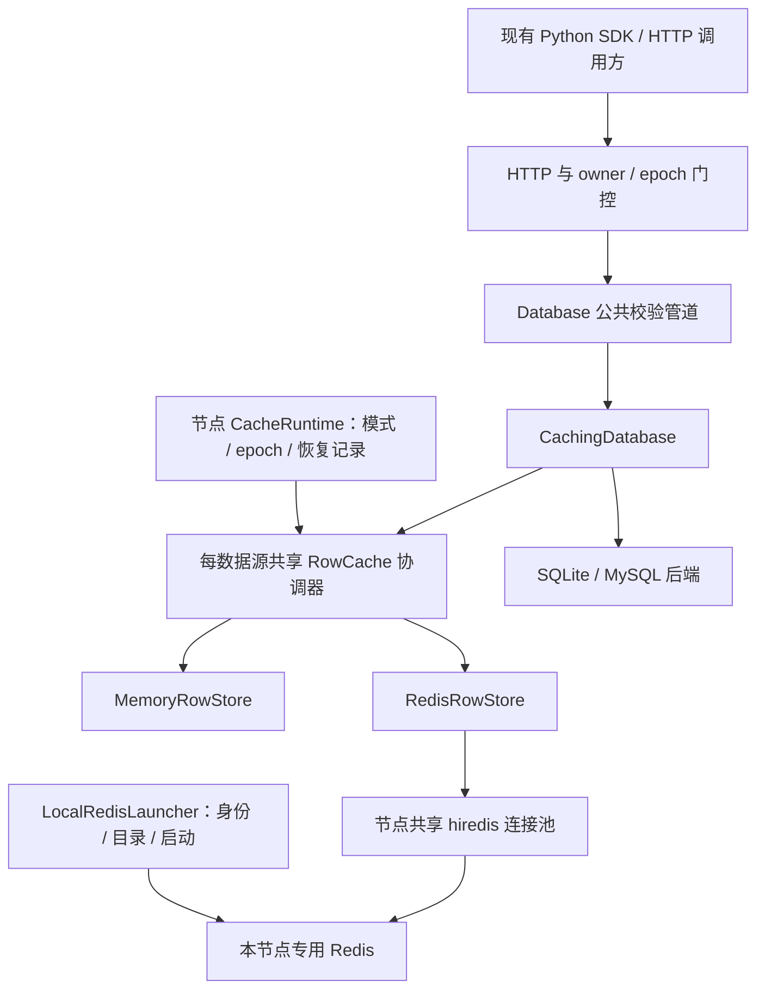
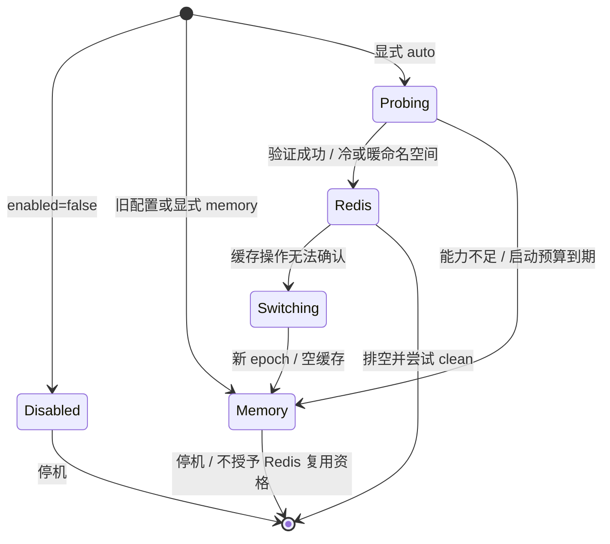

# CppPools 节点本地 Redis 行缓存设计与实施方案

**状态**：设计方案，功能尚未实现。  
**修订**：R3，2026-10-07。  
**依据**：当前仓库源码、集群缓存规范及节点本地 Redis 行缓存需求。  
**范围**：架构、配置、生命周期、故障边界、分阶段 TDD、测试与验收。本文中的新增配置、组件和测试均是实施要求，不代表当前程序已经支持。

**实现顺序**：见 [统一实施路线](implementation-roadmap.md)。必须先完成 S0 的五项高优修复；之后 P0 只负责基线/接口冻结，P1–P2及P3的共享transport归入S3，其余P3–P7归入S4；动态拓扑集成在S6复用本方案的协调器和后端token。

## 目录

1. [目标、范围与结论](#1-目标范围与结论)
2. [当前代码基线与设计落点](#2-当前代码基线与设计落点)
3. [方案选择与组件边界](#3-方案选择与组件边界)
4. [配置契约与默认值](#4-配置契约与默认值)
5. [运行状态与恢复资格](#5-运行状态与恢复资格)
6. [请求路径、并发与失败处理](#6-请求路径并发与失败处理)
7. [键、值、TTL 与容量](#7-键值ttl-与容量)
8. [持久化恢复与停机协议](#8-持久化恢复与停机协议)
9. [Redis 实例管理、客户端与构建](#9-redis-实例管理客户端与构建)
10. [可观察性与契约更新](#10-可观察性与契约更新)
11. [分阶段实施与 TDD 门槛](#11-分阶段实施与-tdd-门槛)
12. [测试矩阵与验收执行](#12-测试矩阵与验收执行)
13. [发布、迁移与回退](#13-发布迁移与回退)
14. [设计评审与交付检查](#14-设计评审与交付检查)

## 1. 目标、范围与结论

每个 CppPools 节点可以使用一份独立的本地 Redis 保存行缓存。在满足恢复条件时，缓存可以跨 CppPools 进程的正常重启保留；Redis 不可用时，服务退回现有内存缓存，数据库继续作为数据真源。

本设计采用 **Redis 与内存二选一** 的存储模式。Redis 模式没有额外的内存行缓存层，内存中只保留协调状态、Singleflight、世代号和统计信息。各节点的 Redis 不复制、不互查，不承担数据库备份或数据同步。

普通用户只需要理解 `cache.enabled`、`cache.backend`、`cache.ttl_ms`。已有容量、缓存表白名单等字段继续有效；Redis 的端口、目录、连接池和持久化设置都有默认值，可按需覆盖。

### 1.1 必须满足的要求

| 编号 | 要求 |
|---|---|
| R01 | 未配置 backend 的旧配置保持原内存模式；缺少 cache 段仍关闭缓存 |
| R02 | auto 模式尝试本地 Redis；未编译客户端、未安装服务端或无法使用时退回内存 |
| R03 | 每数据源的所有数据库连接共享同一缓存协调器；每节点 Redis 独立 |
| R04 | 保留校验管道、完整行缓存、投影顺序、重复列、REAL 键旁路及不缓存空结果 |
| R05 | 保留 I0：关闭缓存、Fallback、epoch bypass 都不能跳过缓存表的写失效 |
| R06 | 保留 I1：blacklist_ttl_ms >= ttl_ms；TTL 不被慢查询、网络排队或重启延长 |
| R07 | 世代比较与回填写入有统一串行化边界；旧 flight 不得完成或删除新 flight |
| R08 | Redis 故障后进入空内存缓存，本进程不再切回 Redis；旧请求不得污染新缓存 |
| R09 | 恢复是否可信有明确判断；异常退出、Redis 重启和配置漂移不得复用旧命名空间 |
| R10 | 自动启动只操作本节点登记的专用实例，不接管任意占用端口的 Redis |
| R11 | hiredis 可选构建；第三方类型留在私有实现，默认构建不下载依赖 |
| R12 | 保留现有 HTTP/SDK 契约，补充可观察的后端状态；阶段验收有可重复证据 |

### 1.2 一致性承诺与适用前提

沿用原集群缓存设计的 TTL 有界滞后模型，不升级为数据库与 Redis 的分布式事务。目标表原则上由本 CppPools 部署写入；外部应用直接写库时，本节点无失效通知，最多依赖已有条目 TTL 收敛。SQL 的结果及重试语义仍由数据库和现有 API 决定。

暖复用进一步要求同一实际 DB 目标的单节点 CppPools 写入进程按顺序接力，**运行期不重叠**。source journal 只检测有序启动介入，不是提交日志，也不能自动识别所有已经运行的写入者。因此 `cache.warm_reuse` 默认 `false`；只有能证明同一数据库写入者按顺序接力的部署，才显式设置为 `true`。多个独立服务即使都没有 cluster 段，也属于多写入者部署，必须保持 `false`；仍可使用 Redis，但每次启动冷。存在外部写入者、不同主机/用户写同一库或不能证明单写入者前提时同样禁用暖复用。这样保留用户显式选择的正常重启复用能力，同时不让最小 auto 配置默默开启无法自动证明安全的恢复模式。

现有按不同唯一列访问同一行的别名失效限制仍存在：update/delete 不能从返回的行数推导所有旧唯一键。已知键立即失效，未知旧别名依赖 TTL。Redis 持久化不能扩大这个窗口，也不能宣传为单节点所有唯一键之间的强一致。修复全部别名需要另行设计数据库读改写契约，本方案不借机修改 `Database` NVI。

Redis 使用墙上时钟处理过期，内存缓存使用单调时钟。Redis 模式要求本机时间稳定；检测到显著时钟跳变时转入冷内存缓存。跨停机期间的时钟变化无法由进程完全观测，不能声称物理时间下无条件的 TTL 硬保证，处理规则见 §7.3。

### 1.3 首版范围

首版支持 `memory` 和 `auto` 两个 backend。`auto` 是显式选择的尽力使用策略；Redis 缓存故障不会使健康数据库无法提供 CRUD。首版不增加要求 Redis 必须成功的 `redis` 严格模式，以免把可丢弃缓存变成启动依赖。

不引入 Redis Cluster/Sentinel、跨节点共享缓存、Redis 分布式锁、负缓存、后台热切回、DDL、任意 SQL、新 CRUD 端点或第二套 SDK 路由。自动启动不安装 Redis、不下载服务端，也不要求管理员权限。

## 2. 当前代码基线与设计落点

与动态发现组合时，遵守[跨方案对齐契约](implementation-roadmap.md#4-三份方案必须共同遵守的对齐契约)：首版discovery.enabled=true必须warm_reuse=false；节点专用缓存Redis与共享中心独立。私有有界transport首次实现即放在src/redis，由两者复用，缓存连接池及RowStore仍属于db。

RowCache后端token增加独立topology_revision时不替换backend_epoch/namespace/flight_id。发现准入gate不能覆盖Redis网络等待；后端lane中读取后复核token再返回，拓扑clear对于Redis旋转namespace，对于memory清条目。enable/disable/Rejoin使用同一退休入口，人工enable不能越过发现blocked/hold-down。缓存正常收尾先完成恢复清单，再由main在所有资源关闭后发布CLI终态。

核对基线：Git HEAD `6c554dd`。Redis 缓存尚未实现；下表只描述该基线中已核对的代码事实和拟实施落点。

| 当前文件 | 当前事实 | 后续实施落点 |
|---|---|---|
| `include/cpppools/config/config.h` | Cache 含 enabled、容量、ttl、blacklist_ttl、tables；没有 backend/Redis 字段 | 增加配置值类型；不公开 hiredis 类型 |
| `src/config/config.cpp` | 标准 JSON；未开注释解析；缺省 blacklist_ttl 为 60000；启动拒绝违反 I1 | 分清旧配置兼容与 auto 默认推导；精确校验新增字段 |
| `src/db/datasource_registry.cpp` | 每数据源创建一份 RowCache，注入该源全部连接装饰器 | 保持共享粒度，接入节点级运行状态与存储工厂 |
| `src/db/row_cache.h` | 分片 LRU/TTL、分片级世代、Singleflight、clear、kill-switch、统计。join flight 与另行读取 generation 之间存在竞态：同分片另一键失效可使旧 promise 未兑现 | P0/P1 必须先用确定性测试复现并修复；之后提取私有存储边界，保持 RowCache 为稳定协调入口 |
| `src/db/caching_database.h` | 完整行回源、投影、写前/写后失效；TTL 从 read_started 开始。bypass 状态目前由 CRUD handler 在正常返回路径复位 | 用作用域清理确保异常路径归还连接前复位；将读取时间及带身份的 flight token 传给协调器 |
| `src/server/http_server.cpp` | 直接消费 RowCache 指标；Rejoin 调 clear；控制接口调 set_enabled。缓存启用时 `/metrics` 对 `cpppools_cache_bypass_total` 重复输出 HELP/TYPE | 指标扩展前先合并为唯一指标声明，并增加重复声明测试 |
| `src/main.cpp` | 建 registry 后启动 HTTP；信号停 accept 并排空 | 在监听前完成恢复判断；在真正排空后记录 clean |
| `CMakeLists.txt` | 无 hiredis 或 Redis 构建选项 | 增加显式可选客户端发现和条件测试 |

Redis/MySQL 联合验收另有一个现存构建阻塞：`src/db/mysql_database.cpp` 的 update 路径把 `vector<ColumnInfo>` 赋给 `ResultSet::columns`（`vector<string>`）。进入 MySQL ON 验收前须先修正并真实完成该构建；依赖缺失或测试 SKIP 不能算通过。

现有 `RowCache::clear()` 的注释称“不抬世代”，但实际实现会递增各分片世代并退休 flight，测试也要求旧回填被丢弃。实施以源码和测试为准，同步修正该注释，不能按过时注释削弱行为。

相关约束入口：

- [仓库工作约束](../AGENT.md)。
- [集群与缓存设计](superpowers/specs/2026-08-11-cluster-cache-design.md)。
- [缓存与 schema 加固计划](superpowers/plans/2026-08-17-cache-schema-correctness.md)。
- [服务端 API](api/backend_api.md)、[Python SDK](api/sdk.md)。
- [项目架构](../skills/cpppools-dev/architecture.md)、[验证环境](../skills/cpppools-dev/verification.md)。

## 3. 方案选择与组件边界

| 方案 | 成本与效果 | 结论 |
|---|---|---|
| 现有 RowCache 外增加可选 Redis 存储 | 保留已验证的协调逻辑；增加一次本地网络访问与生命周期管理 | 采用 |
| Redis 保存行和世代，用 Lua 实现全部 CAS/Singleflight | 多进程协调并非需求；元数据被淘汰、恢复回滚、脚本升级都增加证明成本 | 首版不采用 |
| 内存 L1 + Redis L2 | 两份数据、两次失效、故障切换状态更多；单节点需求没有给出收益依据 | 首版不采用 |

本地 Redis 一般比进程内缓存慢。选择它的价值是进程外保存和内建过期/容量管理；是否值得在具体负载上开启，必须用 §12 的对比测量判断。

### 3.1 架构图



同一时刻只启用一种行存储。数据库连接池与 Redis 连接池相互独立，不修改三级池化的借还契约，也不将 Redis 池加进现有 DB 连接池。

### 3.2 组件职责

| 组件 | 职责与边界 |
|---|---|
| RowCache | 保持当前消费入口；管理 enabled、flight、分片世代、投影前的完整行结果及统计 |
| MemoryRowStore | 移入现有条目/LRU/字节配额/单调 TTL 行为；保持旧模式可观察行为 |
| RedisRowStore | 编码键和值、GET、带绝对期限 SET、批量 DEL；报告状态，不决定 HTTP/SQL 重试 |
| CacheRuntime | 每节点一个；选择模式、维护 backend_epoch、执行单向故障切换、管理恢复清单 |
| RedisConnectionPool | 固定上限、RAII 独占租约、借用期限、超时连接丢弃；私有 transport pump 控制网络总期限与回复字节预算；不存行数据 |
| LocalRedisLauncher | 启动/识别本节点专用 Redis；维护实例身份和生成配置；不进入请求处理代码 |
| CacheLifecycle | 不依赖 hiredis 的本地恢复记录、运行锁和按 DB 目标共享的启动序号；纯内存构建也能废弃已有恢复资格 |

上述均为私有实现。继续使用 `server → {pool, db} → config` 的依赖方向，db 不反向 include server。公开 registry 中已有 RowCache 前置声明可以保留；新的运行上下文在组合根传入，采用不暴露第三方的值或前置声明类型。若需要扩展 registry 构建入口，保留现有 `build(sources, cache_cfg)` 可用，并补兼容性测试；本设计不修改 `Database` 的公开 CRUD 或 `do_*` 钩子。

## 4. 配置契约与默认值

### 4.1 最小配置

以下是拟支持的完整标准 JSON 示例，文件位置仍通过现有 `--config`、`CPPPOOLS_CONFIG` 和默认路径解析规则确定。

```json
{
  "server": { "port": 8080 },
  "cache": {
    "enabled": true,
    "backend": "auto",
    "ttl_ms": 60000
  },
  "datasources": [
    {
      "name": "main",
      "type": "sqlite",
      "default": true,
      "pool_size": 8,
      "sqlite": { "path": "data/main.db" }
    }
  ]
}
```

`enabled` 控制是否使用行缓存；`backend: auto` 允许尝试 Redis 并退回内存；`ttl_ms` 控制从数据库读取开始计时的最长条目寿命。三项之外均可省略。默认不会跨 CppPools 重启复用缓存；满足 §1.2 单写入者前提时，再显式加入 `"warm_reuse": true`。SQLite 路径的既有解析语义不在本方案中改动，实施时由实际连接目标生成指纹。

旧配置例如 `"cache": {"enabled": true}`，仍使用内存；不是悄悄开始访问本机 Redis。关闭缓存不启动 Redis，不建立其连接池。

### 4.2 配置兼容矩阵

| 配置 | 行为 |
|---|---|
| cache 缺省 | 关闭行缓存；保留现有默认行为 |
| enabled=false | 无缓存读/回填；已有持久化恢复资格必须废弃 |
| enabled=true，backend 缺省 | memory，保持旧配置校验和容量口径 |
| backend=memory | 内存；不连接/启动 Redis；废弃已有恢复资格 |
| backend=auto，有客户端与可用专用实例 | Redis；先通过 §8 的恢复判定 |
| backend=auto，客户端未编译或运行条件不足 | 空内存缓存；记录固定原因 |
| backend 未知值、类型错误、非法数字 | 配置错误，启动失败；不当作 Redis 故障吞掉 |
| Redis 段语法合法，但认证失败/权限不足/端口不可用 | auto 退回内存；不改变有效数据库配置 |
| Redis 段存在，backend 缺省或 memory | 校验该段，记录未启用提示；不据此隐式选择 auto |

### 4.3 通用字段

| 字段 | 默认与约束 | 语义 |
|---|---|---|
| enabled | false，布尔 | 原字段 |
| backend | 缺省 memory；仅 memory/auto | 新增，显式选择 |
| ttl_ms | 60000，正整数且期限运算不溢出 | 全部后端同一读取起点 |
| blacklist_ttl_ms | 旧配置/显式 memory 保持 60000；显式 auto 且缺省时取 max(60000, ttl_ms) | 显式值小于 ttl 一律拒绝；auto 推导值按现有 cluster TTL 字段下发 |
| max_entries | 100000，正整数 | 每数据源内存回退容量；Redis 模式不承诺条目数上限 |
| max_bytes | 268435456，正整数 | 每数据源内存回退的逻辑行字节上限；不等于 Redis 总内存 |
| max_entry_bytes | 65536，正整数 | 沿用现有逻辑行大小算法，所有后端均检查 |
| tables | 空数组表示全部，元素是非空字符串 | 沿用缓存表白名单 |
| version | 空字符串，最长 128 字节 | 新增可选人工缓存版本；换库/恢复数据库时变更，触发冷缓存 |
| warm_reuse | **false**，布尔 | 新增可选；显式 true 才启用跨正常 CppPools 重启暖复用；只在单节点、单写入进程顺序接力前提下有效；多写入者必须 false，多节点配置无论此值始终冷 |

容量字段保留在原 `cache` 层，不搬进 Redis 段。Redis 模式由专用实例 `maxmemory` 管总容量；不会为了模拟 max_entries 再维护一套 Redis 行索引和逐源 LRU。max_entries/max_bytes 在 Redis 下只配置回退内存，启动日志明确提示这一口径。

旧配置中 `ttl_ms > 60000` 且未设 blacklist_ttl 原本会校验失败，兼容路径继续失败；只有显式采用新 auto 策略时才推导黑名单默认值。该区别必须在迁移文档中给出示例。

### 4.4 Redis 高级字段

以下字段均放在 `cache.redis`，不是必填项。

| 字段 | 默认 | 校验与作用 |
|---|---|---|
| host | 127.0.0.1 | 首版仅数值回环地址；不做无限制 DNS 解析或远程连接 |
| port | 6380 | 1..65535；不自动扫描其他端口 |
| database | 0 | 非负、可表示为 int32；服务端 SELECT 不支持时退回内存 |
| key_prefix | cpppools | 1..64 字节，字符限 ASCII 字母数字及 `._-`；不是节点身份替代物 |
| username | 空 | 已有专用外部实例的可选 ACL 用户 |
| password_env | 空 | 可选环境变量名；只在进程内解析，不写入日志/生成配置/状态清单 |
| connect_timeout_ms | 50 | 正整数；包括客户端握手的总预算分配 |
| command_timeout_ms | 50 | 正整数；每次命令不能超出剩余操作预算 |
| acquire_timeout_ms | 20 | 正整数；独立于 DB 池借用超时 |
| operation_timeout_ms | 100 | 正整数；一次缓存操作的总预算，含借连接、等分片锁、命令往返 |
| pool_size | min(8, 实际 worker 数)，至少 1 | 1..256；全节点共用，不按数据源或 DB 连接重复创建 |
| auto_start | true | 仅允许启动/复用已登记专用实例；false 显式连接运维提供的本地专用实例 |
| executable | redis-server | 本机可执行文件名或绝对路径；不执行 shell 字符串 |
| startup_timeout_ms | 2000 | 正整数；总启动期限包含探测、启动、加载数据、建池；不能每步重新计时 |
| data_dir | 状态根下的 redis 子目录 | 覆盖时相对配置目录解析；规范化绝对路径；独占并验证归属 |
| maxmemory_bytes | 268435456 | 正整数；只用于生成由本程序启动的专用实例配置 |
| eviction_policy | allkeys-lru | 首版仅 allkeys-lru、allkeys-lfu、noeviction |
| persistence | aof | none/rdb/aof，仅控制自启实例；不是数据库耐久性配置 |
| appendfsync | everysec | aof 时允许 everysec/always/no |

所有大小在转换到 size_t 前检查范围，所有时长在相加和转换到毫秒期限前检查范围。command/acquire/connect 超时不能大于 operation_timeout；startup_timeout 必须至少容纳一次 connect_timeout。超时取值是首版起始默认，性能阶段依据实测调整，不能用这些数值宣传已达成性能指标。

自动启动模式下提供 username/password_env 会被配置校验拒绝：首版生成的实例只绑定回环并使用专用目录，不把凭据写入生成配置。需要 ACL 的部署使用 `auto_start=false` 的运维实例。password_env 指定但未设置/为空时，属于配置错误；认证被服务端拒绝才属于运行期能力不足。

`auto_start=false` 时，executable/data_dir/maxmemory/eviction/persistence/appendfsync 的显式设置应拒绝，避免用户以为程序会改写外部实例。省略这些设置则忽略其内部默认值。该实例必须是本节点专用的单机 Redis，具备 TYPE、GET、STRLEN、SET、DEL、EVAL、SELECT、PING、TIME、INFO 所需权限，不启用 Cluster/只读副本；启动检查失败即回退。

### 4.5 带注释的配置展示

用户希望配置简单并能看懂注释。本文采用“可运行 JSON + 字段说明表”；下面 JSONC 只用于解释，不可直接交给当前或首版的标准 JSON loader。

```jsonc
{
  "cache": {
    "enabled": true,        // 是否开启行缓存
    "backend": "auto",      // 尝试本地 Redis，失败自动用内存
    "ttl_ms": 60000,        // 从数据库读取开始计时；读命中不续期
    "redis": {
      "port": 6381,         // 同机第二节点应使用不同专用端口
      "auto_start": true    // 不会安装 Redis，也不会接管其他实例
    }
  }
}
```

首版不引入 JSONC 解析功能；如以后要求配置文件本身带注释，应单独增加明确解析契约及测试，不能用字符串删除 `//` 的方式破坏 URL/密码。现有配置字段位置和示例 JSON 的格式保持兼容。

## 5. 运行状态与恢复资格

### 5.1 节点级状态机



backend 模式与运行时 kill-switch 是两个维度。`cache/disable` 停读缓存并废弃在途回填，写失效仍按当前模式执行；`cache/enable` 重新允许当前后端的读，不执行 Redis 恢复或重连。Redis disable 必须原子换本源 namespace 并退休协调状态，再返回控制响应：已发送的旧 SET 只能落在旧空间，不能在随后 enable 时复活。仅加 enabled 标志或结束时检查 epoch 无法阻止服务端已执行的 SET。

memory disable 在现有分片临界区内递增 generation、退休在途 flight，保留已完成的条目和原期限；enable 后可按原 TTL 读取这些条目。该差异避免给旧内存控制接口增加无必要的全清空，同时对 Redis 的在途网络写入给出真实 fence。启动配置 enabled=false 时仍按原接口返回受影响数据源数为零。

一个节点共享 Redis 连接池，一次客户端/服务端不确定故障触发节点级回退，避免同节点不同数据源继续使用可疑实例。每数据源保留独立的 namespace、分片协调状态和内存容量；clear/Rejoin 可逐源旋转 namespace。

### 5.2 backend_epoch 与请求 token

每个缓存请求携带 `(backend_epoch, datasource_namespace, shard_generation, flight_id)`。backend_epoch 在切换时递增；namespace 在 cold start/clear 时更换；generation 在失效时递增；flight_id 唯一标识一次合并回源。

禁止只传一个裸 generation：重启、clear、切换及同键新 flight 都可能让世代数字相同但身份不同。创建 flight 与获取 generation 必须在同一协调临界区完成，避免现有“先 join、后单独取 generation”在未来后端接入时产生身份裂缝。

旧 token 无法写入当前存储，无法完成/删除新 flight，也无法让 follower 从旧 future 返回缓存命中。leader 自己已执行的数据库查询按原数据库结果返回；不为了回填失败重发 SQL。follower 被退休后自行通过数据库读取，继续遵守原查询语义。

### 5.3 启动与失败策略

配置错误和数据库建池失败仍 fail-fast。Redis 初始化失败属于 auto 的缓存能力不足；记录原因后使用空内存缓存。状态根不可写但没有历史恢复清单时使用内存，不启动 Redis；无法废弃已有 clean 清单时必须启动失败，防止后续误认本次数据库写入没有发生。

同一状态身份的运行锁被另一个活进程持有时启动失败，而不是退回内存后让两个进程轮流写同一库却留下可复用清单。这是本地缓存实例的独占约束，不是 Redis 分布式锁。

## 6. 请求路径、并发与失败处理

### 6.1 select 路径

1. 继续由 NVI 校验表、列、唯一 where 和类型，归属门控决定 bypass。
2. 读旁路时直接访问数据库，不借 Redis 连接，不创建 flight。
3. 记录当前 backend token；执行有回复长度上限的 GET 协议（§7.2），命中前验证格式、绝对期限与 token。
4. GET miss 到创建/加入本地 flight 必须保持同一次 lane 持有；leader 的世代和 flight_id 在短协调锁内原子获取。不能先放开 lane、稍后凭旧 NIL 创建 flight，否则先行 leader 已 SET/完成后会被迟到 miss 重复回源。注册完成后立即释放 lane 和 Redis 租约。
5. leader 在数据库读取开始时同时记录单调时间和墙上时间；读取完整行。
6. 返回非空成功结果时，验证 token、大小和剩余 TTL；在串行化边界内回填。
7. 对等待者只完成与本 flight_id 匹配的 promise，结果同时携带 token 和读取起点/期限。错误、过期、失效或切换导致的退休返回空结果；follower 使用前再检查 token 与期限，不能让新 flight 接收旧值，不能把超期回源结果当缓存命中。
8. leader 按请求投影数据库结果；命中保持请求列顺序、重复列与 schema 全列顺序。

后台存储 miss 不直接累加 misses；沿用一次新回源 leader 计一次的口径。Redis NIL 只是正常 miss；坏条目、错误回复和连接错误按 §6.4 区分。

### 6.2 写路径与 I0

继续使用“前置失效 → SQL → 后置失效”。缓存表的写失效不检查读 enabled/bypass；SQL 成功后，包括影响 0 行，执行后置失效。SQL 失败仍保留前置失效已产生的世代变更。

- insert：前置覆盖请求给出的唯一键；成功后覆盖这些键和返回的自增 id。
- update：前/后覆盖 where 键；成功后还覆盖被设置的已知新唯一键。
- delete：前/后覆盖 where 键；未知旧别名仍按 §1.2 的 TTL 限制处理。

每次前置/后置失效都重新取得当前 CacheRuntime 快照，并是一个有总期限的操作。写不能沿用前置失效时捕获的旧 Redis 句柄执行后置失效，否则跨切换期间填入内存的旧行可能残留。多个已知键合并成一个 DEL，协调器按分片编号升序取得需要的 lane，并递增受影响分片的 generation、退休对应 flight；不对每个键重置超时预算。

前置 Redis 失效失败时先完成逻辑回退，再执行 SQL；后置失效失败时逻辑回退后返回 SQL 的原结果。**数据库已成功的写，不能因为 DEL 失败改成可重试的通用后端错误**，否则无键 insert 可能被客户端重复执行。这里的安全来自停止使用整个可疑 Redis 命名空间，不是声称 DB 和 DEL 原子提交。

数据库提交后、后置失效前进程崩溃的窗口由 §8 的运行期 dirty 清单处理：下次启动冷缓存。运行期始终 dirty，不靠每笔写临时更新磁盘状态，因此没有“先提交 SQL、后记录 dirty”的崩溃窗口。

### 6.3 串行化、锁顺序与有界等待

Redis 不保存世代号。首版用本进程协调状态和每分片 `StoreLane` 串行化存储操作，要求同一缓存身份只有一个 CppPools 活进程。

锁顺序固定为：**先借独占 Redis 连接 → 按分片编号取得 lane → 进入短协调锁**。短协调锁只处理 generation/flight/token，不在其中访问网络、数据库或等待连接池。lane 可以包围一次同步 Redis 命令，但借连接、等 lane 和网络均消耗同一个 operation_deadline；数据库调用和 future 等待在全部 lane/协调锁之外。

回填在持有 lane 时检查 generation，释放短协调锁后执行 SET，期间继续持有 lane；失效不能在“比较世代”和“完成 SET”之间执行 DEL。GET 也经过同一 lane，防止在失效操作未完成时把存储结果当作已完成写后的命中。回填结束再次验证 backend token，完成 promise 前验证 flight_id；follower 使用结果前再次验证其 token。

到期拿不到连接/lane，或无法确认命令完成，按 Redis 不确定故障处理并回退。内存模式保持现有普通分片锁路径，不引入网络预算。跨分片失效的 lane 永远升序取得，释放后才处理节点级清理，避免与全量切换形成反向锁序。

切换先用原子状态/epoch 使旧 Redis 请求失去资格，再发布独立的空内存存储与新协调状态；不等待旧网络 I/O 才允许后续请求回源。旧连接的在途租约由 RAII 持有，禁止切换线程强行释放其 redisContext。旧 future 通过短协调锁退休；任何正在完成的等待者都要检查 epoch，因此清理进度不影响安全性。

### 6.4 故障分类

| 情况 | 处理 |
|---|---|
| GET 返回 NIL，TTL 已到，条目被正常淘汰 | 正常 miss；不回退 |
| 正常读取超 max_entry_bytes 的 DB 行 | 返回 DB 结果，不缓存，计 too_large |
| 单条值格式错误/版本错误/期限缺失 | 不返回该值；有界 DEL 清理，计 corrupt；DEL 失败则回退 |
| GET/SET/DEL 超时、I/O 错误、回复类型异常、认证/权限变化、只读或 OOM 错误 | 原子标记可疑并转空内存；当前请求继续其数据库语义 |
| Redis 池或 lane 在操作期限内不可得 | 视为缓存容量/延迟故障，单次转内存；不让所有请求持续阻塞 |
| Redis 运行期重启，旧连接断开 | 首次失败即回退；不自动 reconnect 后使用恢复数据 |
| 新建连接检测 run_id 不一致 | 回退；首版运行期不补建/重连 Redis 池 |
| 内存回退行缓存分配失败 | 停止缓存读/回填，数据库直通；不得返回旧 Redis 条目 |
| DB 自身错误 | 维持原 DbStatus/HTTP 行为；不因缓存掩盖错误 |

关闭缓存前已经开始的操作按 §5.1 的 namespace/generation fence 处理；重新开启读只使用当前命名空间。clear/Rejoin 在协调层旋转 namespace、退休 flight、清内存，Redis 下不发送 FLUSHDB/FLUSHALL，不枚举或删除整个数据库。旧行自然按原期限过期。

## 7. 键、值、TTL 与容量

### 7.1 Redis 键格式

Redis key 由版本前缀、部署实例身份、数据源命名空间、数据源名、表名、唯一列名、键值类型和值构成。所有可变段使用显式长度前缀；整数使用固定字节序的 64 位有符号编码，字符串按字节长度处理。整数 42 与字符串 "42" 不同键；内嵌 NUL、分隔符和 Unicode 不应碰撞。

现有 `RowCacheKey::encode()` 用本机字节序写长度/整数，适用于进程内，不直接作为持久化跨构建格式。Redis codec 定义独立版本 `v1` 与确定字节序；网络二进制参数使用 hiredis 的 argv+长度接口，不拼接 Redis 命令字符串。首版延续 REAL where 键旁路。

部署身份不只使用 key_prefix。默认身份关联规范化配置绝对路径，集群 node_id 和实际监听标识进入恢复指纹；每数据源 namespace 是独立随机 128 位标识。不同实例误用同一 prefix 不应撞行键；配置身份冲突由启动归属检查拒绝。

### 7.2 值格式与大小

私有 codec 保存带版本的二进制完整行：magic/版本、namespace、绝对过期毫秒、列数量、每列长度与值类型、值内容。NULL、int64、double、字符串有显式类型标签；int64 不经浮点或十进制 JSON 中转，double 以确定 IEEE 754 binary64 字节序保存。平台不满足该表示要求时拒绝 Redis 能力并退回内存。

解码先检查回复长度、长度字段与剩余字节、列数和 schema 对应关系，再分配内容。缺列、重列、未知标签、截断、整数溢出、非有限 REAL 和版本不匹配均为 corrupt miss；不得用 NULL 补齐损坏的缓存行再返回成功。

逻辑行大小沿用现有 row_bytes 算法。另限制编码后的 key 和 value，防止长度前缀/列名把网络分配放大：key 上限 1 MiB，value 上限为 `min(1 MiB, 2 * max_entry_bytes + 4096)`，先检查运算溢出；超限只旁路，不让数据库请求失败。

同步 hiredis 的普通 GET 在 codec 校验前可能已分配整个 bulk reply，因此首版不用无界 GET。私有固定只读 Lua 脚本在 Redis 端先检查类型和 STRLEN，超上限返回固定的 corrupt 标记，否则返回 GET 值；脚本无扫描、无循环、无写入。用 EVAL 发送固定脚本与二进制参数，避免脚本缓存失效导致重试。这个脚本仅约束回复大小，世代 CAS/Singleflight 仍在本进程，不能把它误认为跨 DB 的原子事务。启动探测要验证 EVAL 与内部命令权限。

所有命令还经过 §9.4 的有界 transport pump：读取行命令的回复预算为已配置 value 上限加 4096 字节协议余量；INFO 等控制回复预算固定 256 KiB。超过预算在继续读取/喂给 hiredis reader 之前终止并丢弃连接。reader 的聚合元素数量、嵌套深度和声明长度同样受限，不能让一个很短的恶意数组头触发巨量预分配。hiredis 的 maxbuf 是空闲缓冲回收阈值，不能当作活动 bulk reply 上限。

### 7.3 TTL 的准确起点

定义 `read_started_steady`、`read_started_wall_ms` 为真正开始完整行 DB select 的时刻；不是请求到达、flight 创建或 SET 时刻。

回填前计算单调时钟剩余寿命，向下取整毫秒；不大于零则不缓存。绝对期限取“读取开始的墙上时间 + ttl”与“当前墙上时间 + 单调剩余寿命”中较早者。用一次 `SET key value PXAT deadline_ms` 原子写值与过期，不能分开 SET/PEXPIRE。GET 不续期，正常重启、切换和暖恢复也不重新写 TTL。

使用 PXAT 是本方案对早期讨论中 SET PX 的修订：PX 从 Redis 执行命令时开始计时，无法扣除客户端发送后的排队/网络延迟；绝对期限不会因这些延迟重新获得完整 TTL。Redis 的 [SET 文档](https://redis.io/docs/latest/commands/set/) 定义了 PXAT，且[过期文档](https://redis.io/docs/latest/commands/expire/)说明持久化保留绝对时间、停机期间时间继续流逝。

payload 的期限必须与 key 的期限一致；命中检查 payload 到期。启动使用 TIME 校验回环实例与本进程墙上时间是否可接受，差异大于 100 ms 直接退回内存。运行时每次缓存操作比较墙上/单调时间增量，检测到大于 100 ms 的突变则回退；暂停很久的进程也必须在恢复后、返回缓存命中前检查。100 ms 是检测容差，不是额外续期。停机后墙上时间早于记录的 clean 时间时冷启动；时间不稳定的部署应使用 memory。

### 7.4 容量与持久化

自启实例默认 `maxmemory=256 MiB`、`allkeys-lru`、AOF/everysec。Redis maxmemory 控制实例内存，不等于进程 RSS 硬上限；AOF/重写缓冲及进程开销需额外预算。内存回退仍是每数据源原有 max_entries/max_bytes 配额；N 个数据源的总回退预算不是单个 max_bytes。

Redis 的 LRU/LFU 淘汰导致正常 miss；容量淘汰不代表失效失败。noeviction 下写缓存 OOM 会触发整体回退，避免请求反复等待。Redis [淘汰文档](https://redis.io/docs/latest/develop/reference/eviction/)支持上述容量/策略区别。

持久化选项：none 不生成快照/AOF；rdb 使用自启配置固定 `save 60 1000`；aof 使用 appendonly yes、所选 appendfsync，关闭 RDB 的 save 规则。正常 CppPools 停机保留 Redis 进程，不强制 SAVE/BGSAVE/SHUTDOWN。AOF/RDB 丢写或恢复旧 DEL 的风险不能由缓存容忍度掩盖：只要 Redis 本身重启，旧 namespace 一律不复用，见 §8。

Redis 只为 CppPools 进程正常重启提供暖缓存候选。主机或 Redis 重启后首版冷缓存，即使 AOF 数据还在。持久化仍可用于实例运维和检查，但不意味着自动恢复的数据会成为缓存命中；详见 [Redis 持久化文档](https://redis.io/docs/latest/management/persistence/)。

## 8. 持久化恢复与停机协议

### 8.1 状态目录、独占锁与清单

状态根默认位于配置目录下的 `.cpppools-cache/<配置路径标识>/`，路径标识可复用现有非安全用途哈希的十六进制结果，但清单必须同时保存完整规范化配置路径并作精确比较。哈希碰撞只导致身份冲突并拒绝共用，不得因此认同旧清单。node_id、监听端口和 DB 指纹存于清单而不是只依赖目录名。

状态根和 Redis data_dir 分离：即使用户修改 data_dir，稳定的状态根仍记录每次服务运行，避免改回原目录后误用旧 clean。自启 Redis 默认 data_dir 为该状态根内的 `redis/`。禁止跟随归属不明的符号链接、目录穿越或无身份标记的既有数据目录；处理前规范化目标并验证所属实例。

CacheLifecycle 在所有构建中可用，不依赖 hiredis。auto 模式创建状态根并取得 OS 运行锁；memory、旧配置、enabled=false、无 hiredis 构建若发现本身份已存在恢复记录，也要取得锁并在接收请求前废弃 clean。没有历史状态的旧内存配置不创建新目录，保持兼容。

仅按配置路径管理清单不能发现“用 B 配置 memory 写库，再回到 A 配置 auto”。为封住这个恢复窗口，CacheLifecycle 另维护**按实际 DB 目标共享的 source journal**，存于当前 OS 用户的固定持久状态根：Windows 为 LOCALAPPDATA/CppPools/cache-sources；POSIX 为 XDG_STATE_HOME/cpppools/cache-sources，缺省为用户目录下 .local/state/cpppools/cache-sources。位置与具体配置目录、backend、Redis data_dir 无关，不可放在易清理的临时目录。

source identity 使用 SQLite 规范化实际路径、或 MySQL 配置 host/port/database；不包含配置文件路径、datasource 别名或 DB 账号。每条记录保存完整目标描述、随机 128 位 journal_incarnation 和不回绕的 activation_seq；路径摘要碰撞要比较完整目标，不能合并。首次创建、缺失后重建或损坏后受控重建，都生成新 incarnation。auto 为其目标创建记录，所有新版本构建在 memory/disabled/OFF 下也检查已有记录；没有既有记录的旧内存部署不创建记录。

同一启动的多个源若指向同一目标先去重，只取得一份旧序号并推进一次。按目标 OS 锁串行化“读取旧序号 → 持久写入新序号”，不得让并发 A/B 都从 7 写成 8。所有目标完成后才允许业务写/HTTP；已有记录无法读取、不能判断存在性或无法持久更新时，必须 fail-fast。序号溢出时废弃恢复资格并报告错误，不能回绕。

暖候选保存的 `(journal_incarnation, activation_seq)` 须等于该目标的**本次激活前**二元组；本次运行/clean 保存的是**本次启动取得的 incarnation 与新序号**，不是停机时重新读取的最新值。于是 B 即使换路径、换源别名或关闭缓存，也会推进同一记录，使 A 下次启动冷缓存。记录删除重建即使序号再次相同，也因 incarnation 不同而冷，禁止数字 ABA。目标锁只用于更新，不持有整个运行期；若另一个新进程在 A 运行期间启动，它推进序号也使 A 此后无法暖复用。该记录只检测本机同用户新版本服务的介入，不宣称是数据库提交版本或跨节点协调机制。

MySQL 多个 host/DNS/代理可能指向同一实际库，其他 OS 用户或其他主机也不共享这份 journal；无法规范化为同一目标时按外部写入者处理，必须禁用暖复用部署前提或更换 cache.version。多节点仍一律冷。换旧二进制、原地恢复 DB 也仍需显式 cache.version/冷启动操作；本地 journal 不试图证明它看不到的写入。

**重叠运行反例与处理**：B(memory) 先启动，A(auto) 后启动并退出 clean，B 再提交写，A 又启动；启动序号可能仍等于 A 的记录。因此不允许把“source 序号匹配”单独当作无写证明。首版不增加对所有 DB 写入者的活跃租约或每笔提交协调，部署方必须对这种重叠配置使用 warm_reuse=false；本次运行也不写可暖 clean。若以后要求自动支持多进程暖复用，需另行设计覆盖全部写入者、全生命周期的源活跃资格检测，不能只改一条判断。

运行锁使用 OS 锁/句柄生命周期，不用单纯 PID 文件。强杀进程后锁由 OS 释放，清单仍是 dirty；保存 PID 仅用于诊断。清单只写版本、部署身份、进程运行 nonce、状态、Redis run_id、各源 namespace、恢复指纹、退出时间等，不含密码、Redis 值或业务唯一键。

清单更新必须用临时文件、文件持久化、原子替换及平台支持的目录/替换持久化语义；Windows 明确使用文件刷盘与替换句柄语义，POSIX 刷盘文件和目录。无法满足持久化语义的文件系统不授予暖恢复资格。损坏、缺失、不支持版本的清单默认不可信，不能猜测 clean。

### 8.2 启动顺序

1. 解析并校验标准 JSON，确定实际配置路径、worker 数与实例身份。
2. 检查历史状态；取得运行锁，读取旧清单作为内存中的候选。
3. **先持久写入 dirty/本次 nonce，再允许任何 HTTP 请求或数据库写入。** 若需要废弃历史 clean 却失败，终止启动。
4. 建数据库 registry、探连和 schema 快照；失败保持 dirty。探查不是写业务表。规范化目标、去重并完成 source journal 的持久激活，在内存中保留激活前/本次序号；任何已存在 journal 更新失败都不能进入监听。
5. 显式 auto 且编译客户端时探测专用 Redis，必要时按 §9 启动；全部步骤共享 startup_deadline。
6. 校验 Redis 单机主实例、版本、run_id、TIME、权限和能力，创建固定池。池中各连接的 run_id 必须一致。
7. 按 §8.3 决定每数据源暖复用或新 namespace。内存回退永远是空条目/新 token。
8. 注入共享协调器，启动 HTTP 监听。运行全过程保持清单 dirty。

registry 构建当前把 DB 探测和缓存创建放在一个流程中；实施应在同一组合根分出明确的“DB/schema 就绪 → cache 选择 → 装饰器注入”阶段，不在每个 DB 连接构造函数中重复启动 Redis。现有 build 兼容入口继续支持纯内存。

### 8.3 暖复用条件与冷启动矩阵

暖复用必须同时满足：warm_reuse=true 且遵守 §1.2 的单写入进程顺序接力前提；旧清单 clean；本次能持久废弃旧 clean；部署身份/恢复指纹精确一致；旧清单 source 的 incarnation/序号等于本次激活前二元组；Redis run_id 与退出时相同；实例身份与 namespace 记录完整；未发现时钟回退；数据源支持跨进程存在；属于单节点部署。

“单节点部署”指未配置 cluster 或 cluster.nodes 只有本节点。多节点部署中，节点停机期间可能有其他节点以 Fallback 写同一实际数据库，本机没有可靠通知；**首版多节点 CppPools 进程每次启动都使用新 namespace**。同一运行期仍可缓存，Redis 仍由本节点独占；该限制是恢复安全策略，不修改 I1 或 SDK 黑名单。

| 事件 | 处理与理由 |
|---|---|
| 单节点正常排空重启，指纹一致，Redis 进程一直存活 | 可沿用 namespace；旧条目剩余 TTL 不变 |
| clean 退出但 Redis 已重启/AOF 或 RDB 恢复 | run_id 改变，全部冷；不能信任恢复出的旧 DEL/世代状态 |
| SIGKILL、崩溃、重复信号强退、停机排空超时 | 清单 dirty；全部冷，即使 Redis 正常 |
| 任一 Redis 缓存操作失败并回退过内存 | 本次不产生 Redis clean，下次冷 |
| 中间用 memory、关闭缓存或无 hiredis 构建运行并写库 | 启动已废弃 clean；再改回 auto 时冷 |
| 多节点进程正常重启 | 冷；本地 clean 无法证明停机期间没有 Fallback 写入 |
| warm_reuse=false；包含同库重叠运行的独立单节点部署 | 每次启动冷；本次运行不产生可暖 clean，不把 source 启动序号当作提交版本 |
| topology/epoch/node_id、cache 参数、实际 DB 目标、schema 变化 | 受影响源冷；无法明确范围时全部冷 |
| schema 不变但 SQLite 文件身份改变 | 冷；file id/device+inode 进入源身份 |
| SQLite :memory: 或识别出的 memory URI | 冷；新进程的 DB 本身为空，不允许旧行复活 |
| 同目标原地恢复 DB/换物理 MySQL 库，配置与 schema 未变 | 运维必须递增 cache.version；仅凭地址/路径无法自动识别数据代次 |
| Rejoin/clear | 本源立即换 namespace、退休 flight；不在原空间延长 TTL |
| 清单缺失、损坏、版本不兼容 | 冷；不能以 Redis 内容存在替代清单 |
| 用另一份新版本配置路径/源别名写同一规范目标，再换回 | source journal 已推进，旧 clean 序号不符，冷 |
| source journal 缺失、损坏或被重建 | 新 incarnation，旧 clean 二元组不符，冷；不能只比较重置后的序号 |
| 旧版二进制、其他 OS 用户/主机或未识别的 DB 目标别名介入 | 必须显式换 cache.version/执行冷启动；这些写入不能由本机 journal 自动证明 |

缓存持久化并不让节点变成有状态数据节点：删掉本实例缓存状态的受控维护操作只损失命中率，业务数据仍在 DB。本方案没有自动删除目录的日常动作。

### 8.4 恢复指纹

清单以版本化规范格式保存可精确比较的非秘密恢复描述，而不是用现有 32 位 datasource_digest 作为缓存有效性的证明。至少涵盖：

- 规范化配置身份、实际监听标识、node_id、完整拓扑节点集合和 epoch。
- 数据源名、驱动类型；SQLite 实际规范化路径和文件身份；MySQL 实际 host/port/database 及影响视图的账户身份；密码不保存。
- 自省后的全部表/列顺序、逻辑类型、nullable、主键、单列 unique、自增属性。
- 缓存 codec 版本、cache.version、warm_reuse、tables、ttl、大小限制及容量设置。
- Redis endpoint/database/prefix、实例登记身份、持久化/目录等影响运行策略的有效设置。

完整描述按固定顺序编码比较，摘要只能用于诊断/索引，不能把碰撞当相等。变更 worker/pool 这类纯吞吐参数可以保守冷启动；不为节省一次冷启动引入复杂的逐字段恢复白名单。

### 8.5 正常停机与 clean

停机顺序：停止 accept → 排空已提交 HTTP worker → 等待 DB 写和全部缓存命令/flight 结束 → 确认模式仍为 Redis 且无失败、暖策略允许 → 最后查询并核对 run_id/实例身份 → 持久写入 clean（当前各源 namespace、指纹、本次启动 source incarnation/序号、退出时刻）→ 释放运行锁。warm_reuse=false 或多节点不产生可暖 clean。

当前 `HttpServer::start()` 在停机等待 5 秒后可能调用 `shutdown_now()` 丢弃排队任务，也可能调用 `shutdown()` 完整排空，两个分支都返回 void。实施必须把实际停机结果传到组合根（不改 CRUD/NVI），只有正常排空分支授予 clean；不能只因 start 返回或线程最终被 join 就认定是正常停机。后台指标任务如有引入，也须先停止。clean 写失败只保留 dirty，不把退出成功当作可暖恢复。异常路径不调用 clean；析构函数也不能无条件写 clean。

正常停机不关闭 Redis，所以它可以服务下一次正常 CppPools 重启。Redis 进程是有登记的独立本地服务，不能放入会随父进程退出自动杀死的 Windows Job 或同等父子进程清理机制。Redis 自身停机/主机重启下次冷缓存，数据安全不依赖它能持续运行。

## 9. Redis 实例管理、客户端与构建

### 9.1 自动探测与启动

`auto_start=true` 的启动流程：

1. 只探测配置的回环 endpoint。端口已有服务时先做只读识别；只有实例登记的完整路径、可执行文件、OS 进程创建身份及 run_id 一致，才认定为自己的进程。
2. 未登记 Redis、其他应用服务、PID 被复用或无法证明身份：退回内存，不 CONFIG SET、不写 owner 标记、不 SHUTDOWN、不杀进程。
3. 端口未监听时，检查状态根/data_dir 的持有锁和完整身份标记；用独立的启动锁串行化自启过程。
4. 查找本机 redis-server，参数逐项传递，不拼 shell；失败则回退。启动与探测之间如有人抢占端口，重新核实身份，不能认领抢占者。
5. 原子生成该实例的 Redis 配置；固定回环 bind、protected-mode、专用 dir/pid/log、端口、maxmemory、淘汰及持久化策略。自启使用独立 daemon/服务生命周期，避免每请求创建子进程。
6. 在总期限内等待 Redis 完成加载并验证全部能力；超时则回退。仅当能证明本次创建的 OS 进程身份时才可清理失败启动进程；身份不明时不杀。
7. 写入实例登记。登记失败则该实例不能用于暖恢复或被后续自动接管，本次回退；日志给出实际原因和路径。

既有自启实例配置与用户本次要求不同，不在线 CONFIG SET。auto 退回内存并记录配置不符，运维在停止/重启专用 Redis 后再启动 CppPools。Redis 配置文件由程序生成，不要求用户逐项手写；与业务配置不同，它属于受登记的运行产物。

自动生成实例只为一个节点服务；不同节点不能复用同一 data_dir、OS 进程或 endpoint。仅靠 Redis database 索引隔离多个 CppPools 节点不满足本设计的每节点独立要求。同机多节点显式使用 6380、6381 等不同端口和独立目录；程序不自动改端口，让失败可解释。

### 9.2 运维提供的实例

`auto_start=false` 是连接授权，不是进程管理授权。程序检查兼容性并仅在自己的随机 namespace 下读写键，不改变服务配置、持久化、目录或进程。部署方提供本节点专用单机实例并确保容量上限；若无法确认专用性，不授予暖恢复资格，必要时以冷 Redis 运行仍需本地独占运行锁。

两种 auto_start 模式在只读识别 Redis run_id 后，都须取得用户级固定状态根 `cache-instances/<run_id 标识>` 中的 OS 实例租约，才建立可用池并执行行命令；保存完整 run_id 以核对索引碰撞。租约持有至 CppPools 排空退出，即使中途回退内存也不提前释放。这样不同配置路径、endpoint 别名或 Redis database 索引不能让两个本机同用户新版本节点同时使用同一 Redis 进程。

不同配置身份的实例租约冲突按 auto 能力不足退内存，报告 `instance_in_use`；它已经停止使用该 Redis，并完成本地 dirty/source journal 激活，所以没有绕过 Redis 独占。**同一配置状态身份**的运行锁冲突仍 fail-fast。其他 OS 用户、旧程序或外部 Redis 客户端不受这份 OS 租约约束，专用实例仍是部署前提；该租约不配置、不停止外部 Redis，也不是 Redis 分布式锁。

不创建 Redis 停止 HTTP API。正常 CppPools stop 不停止 Redis；维护人员要停止 Redis 时，用既有系统服务管理工具或经核验的本节点实例信息执行操作。后续 CLI 方案若管理 Redis，应复用本设计的身份记录，不能按端口或 PID 文件直接杀进程。

### 9.3 平台支持矩阵

| 平台/运行方式 | 首版支持策略 |
|---|---|
| Linux 原生、WSL 内同时运行 CppPools 与 Redis | 支持客户端与自启；实施须做真实进程测试 |
| macOS 原生 | hiredis 客户端和 POSIX 自启设计兼容；发布支持需真实构建/生命周期证据 |
| Windows 原生 CppPools，连接已准备的回环 Redis | 通过兼容 hiredis 构建提供客户端；使用 auto_start=false；需要原生验证 |
| Windows 原生自动启动 WSL/Docker/第三方 Redis | 首版不自动调用这些管理器；auto_start 无受支持服务端时退回内存 |
| 未安装 Redis 或不支持的平台 | auto 退回内存；memory 构建和原功能可用 |

Redis 官方的 [Windows 安装说明](https://redis.io/docs/latest/operate/oss_and_stack/install/archive/install-redis/install-redis-on-windows/)提供 WSL 等运行方式；这不等于 Windows 本机存在可直接启动的官方 redis-server.exe。需要完整自启体验时，在 WSL 中运行整套服务。不能把 POSIX 自启测试通过写成 Windows 自启已验证。

### 9.4 hiredis 与连接池

采用官方 hiredis，不手写 RESP，不在请求中调用 redis-cli。基线能力按 hiredis 1.2 或更高的兼容版本、Redis 7.0 或更高的单机实例验证；这两个下限是本方案的支持范围，非“最新版本”声明。发布时锁定 CI 使用的具体版本并记录，升级重新验证。

每个 redisContext 同时只交给一个 RAII 租约。hiredis 官方 [README](https://github.com/redis/hiredis)明确 context 不是线程安全对象，并提供连接/命令超时和二进制 argv 接口。用私有 deleter 释放 context/reply，错误连接不归还为可用连接；超时后无论 Redis 是否实际执行命令，都按不确定处理。

同步是对 RowCache 调用方的接口语义，不要求内部使用 `redisCommand` 的阻塞读写循环。SO_RCVTIMEO/SO_SNDTIMEO 只约束单次系统调用，持续小片段回复可以把整次操作拖长。首版在 RedisConnectionPool 私有实现内使用非阻塞 socket、hiredis 编码/buffer/reader API 与 poll/WSAPoll 的 transport pump：connect、写出、读取每次推进都检查同一绝对 deadline；可读/可写唤醒和 EINTR 不重置预算；到期即废弃连接。

transport pump 用私有非阻塞 recv 按剩余字节预算接收后调用 hiredis `redisReaderFeed`/公开 reply 读取接口；不能直接用会自行接收并 Feed 的 `redisBufferRead` 再做事后计数。写出使用 hiredis argv 编码和非阻塞 buffer 写接口。每个 poll、短读/短写及 EINTR 后都重算期限；正好耗尽字节预算但回复未完成时也失败并弃连接。

首版固定 RESP2，不发 HELLO 3、不接受 push/map；只读脚本返回标量 bulk/NIL 或固定 corrupt 整数。TIME 只允许根数组的 2 个标量元素；其余命令按预期标量校验，禁止嵌套数组。reader.maxelements 设为 2，不能设为 0（无限）；通过 `redisReaderCreateWithFunctions` 的有界 reply callbacks，在数组/字符串等回复对象分配前检查类型、元素数、声明长度、任务父级和整次分配预算。总回复字节 cap 不能替代元素/嵌套分配 cap；也不能把 maxbuf 当作回复长度限制。

上述公开 API 的基线见 hiredis [hiredis.c](https://github.com/redis/hiredis/blob/v1.2.0/hiredis.c) 与 [read.c](https://github.com/redis/hiredis/blob/v1.2.0/read.c)。P3 以伪服务验证巨大数组头、超长 bulk 声明、无 CRLF 长头、嵌套和慢片段都无法造成大分配/无界等待；版本不满足这些约束则拒绝 Redis 能力。它复用 hiredis 解析器，不自行实现 RESP，不改变 HTTP 服务的同步 I/O 模型。启动全部连接的 PING/INFO/TIME/认证、外来端口识别和停机核验都走同一 pump；超限、格式错、未完整回复或多余未请求回复均丢连接，按启动/运行时策略回退。

固定池在启动总预算内建立并认证/SELECT/校验 run_id，运行期不扩容、补建、重新认证或 reconnect。任一槽位失效即节点回退。连接池借用期覆盖短缓存命令，严禁跨 DB 查询和 future 等待持有 Redis 租约。连接/命令超时设置与剩余 deadline 对齐，不能只设置 connect timeout 后让 GET 永久阻塞。

### 9.5 构建策略

新增 `CPPPOOLS_USE_REDIS`，默认 OFF。OFF 时不查 hiredis、不编译 Redis 适配器、不链接客户端、不下载网络依赖；CacheLifecycle 和内存实现仍编译，auto 明确回退并报告 `client_not_built`。

ON 时先发现兼容的系统 CMake package/pkg-config，再允许显式 `HIREDIS_INCLUDE_DIR`/`HIREDIS_LIBRARY` 覆盖。查找结果必须核对 ABI/编译器和能力；ON 却未找到头或库，CMake 明确失败，不能静默变成 OFF。hiredis 头只在私有实现出现；静态库最终链接所需的客户端库通过构建接口传递，不把第三方头加入公开 include。

首版不增加默认 FetchContent。需要源码构建时，由依赖准备步骤下载固定版本到独立前缀并传给 CMake，校验来源与版本；不会在用户配置时隐式联网。Windows 必须匹配 MSVC/MinGW ABI，并正确处理运行时 DLL；库加载失败是二进制交付错误，不能宣传为进程内自动回退能处理的情况。

## 10. 可观察性与契约更新

保留现有 CRUD 状态码、响应字段、SDK 重试分类、cluster TTL 和 cache 控制接口。SQL 已提交而缓存失败仍返回 SQL 的原成功；`cache/enable` 不切回 Redis。部署指纹不发给 SDK，现有 datasource_digest 继续保持原用途。

新增有限枚举的运行状态用于日志和兼容性附加字段：requested_backend、active_backend、fallback_reason、warm_reused。状态不能包含密码、完整业务键、缓存行、Redis 命令或高基数路径标签。

| 输出位置 | 计划内容 |
|---|---|
| 启动日志 | 客户端是否编译；请求/实际后端；暖/冷选择；专用实例身份核验；固定原因码 |
| 运行日志 | 首次故障切换一次，附源和错误类别；重复错误限流，不对每个请求刷屏 |
| `/metrics` | `cpppools_cache_backend_info{backend}` 节点状态；`cpppools_cache_backend_fallback_total{reason}`；按源 corrupt 计数 |
| `/stats`、`/api/v1/get-config` | 保留原字段，新增 cache_backend 状态对象；get-config 中明确这是实际状态，不冒充配置快照 |
| Redis 专用统计 | 新增实例 used_memory、evicted_keys 等，明确是全 Redis 实例值，不伪装成逐源计数 |

既有 hits/misses/invalidations/singleflight/backfill_dropped 等保持定义，并跨后端切换单调累计；计数器由稳定的每源 RowCache 外壳持有，不随 store/epoch/namespace 更换重建。invalidations 按**逻辑键失效事件**计数，前删和后删分别计，不能改成每个批量 DEL 一次；批处理保留输入事件的计数，实际 DEL 可去重。Redis 内部 keyspace_hits 不能直接当作 CppPools 命中，脚本/探测会改变它的口径。

Redis 无法仅凭 INFO 给出每数据源当前 namespace 的精确 entries/bytes/evictions。首版保留原字段，但明确：memory 为原来的精确逻辑存量；Redis entries/bytes 为**本进程已观察条目的估计量**，暖恢复未读条目不计，Redis 淘汰也可能造成高估。用有界本地账本记录 key、逻辑行大小和期限，不保存整行；最多 max_entries 项，且账本自身的 key/记录逻辑字节预算为每源 `min(max_bytes, 16 MiB)`，超出时舍弃最旧账目，不淘汰 Redis 行。该预算限制统计状态，不能解释为整个 C++ 进程 RSS 硬上限。新增 `cache_entries_exact`/`cache_bytes_exact` 标志，Redis 为 false，内存为 true；监控不得用估计值反推数据库容量或全局热度。

| 账本事件 | 存量更新；累计计数不重置 |
|---|---|
| 当前 token 命中 / SET 确认成功 | 按 key upsert 行逻辑字节和原绝对期限，重复观察不重复计 entries，不续期 |
| NIL / 本地到期 / corrupt | 移除该 key 账目；corrupt 另计专用计数 |
| 已知键 DEL 或逻辑失效 | 移除对应账目；无论是否实际存在，都按逻辑事件增加 invalidations |
| namespace 旋转 / clear / Redis disable | 清本源账本；Rejoin 增加原 flushes/rejoin 计数，disable 的空间旋转不冒充 Rejoin、不增加该计数 |
| Redis → memory | 丢弃 Redis 账本，存量切为新空内存的实际值，累计计数保持 |
| GET 命中但账本满 | 按有界淘汰策略换账目，绝不影响实际行或命中结果 |

账本在本地指标快照前清理已知到期项，并用 token 屏蔽晚到旧事件；Redis 自行淘汰未被观察到时仍可能高估，exact=false 始终保持，不因某轮看似完整而变 true。

原逐源 evictions_total 在 Redis 模式只计本进程明确触发的容量淘汰，首版不模拟逐源 LRU，因此通常为零；实例真实淘汰由新 Redis 指标提供。这些口径是新增后端的必要契约补充，实施时必须同步 backend_api/spec 修订记录，不可声称所有指标语义完全不变。指标接口只读本地快照，不在 HTTP 请求中扫描 Redis keyspace 或无限等待 INFO。

固定 fallback_reason 至少包括 client_not_built、unsupported_platform、not_installed、foreign_instance、instance_in_use、startup_timeout、identity_conflict、runtime_io、runtime_timeout、pool_timeout、permission、oom、clock_jump、state_unavailable。配置错误不混入 fallback；状态身份无法安全废弃的错误按启动失败另报。

## 11. 分阶段实施与 TDD 门槛

所有阶段均为**尚未执行**的后续计划。本文不给功能实现代码。实施者先写具体失败用例并记录 RED，再实现最小行为并记录 GREEN，最后重构/回归/评审。配置例子和命令只是实施输入，不是本次新增程序能力。

阶段顺序：P0 基线 → P1 内存存储边界 → P2 配置/codec/可选构建 → P3 显式外部 Redis → P4 故障切换 → P5 恢复协议 → P6 本地自启 → P7 集群/交付验收。外部 Redis 用 P3 验证核心缓存，进程管理后置，避免自启故障掩盖缓存正确性。

### P0：冻结基线与测试条件

**文件**：读取现有 spec、`test/test_row_cache.cpp`、`test/test_caching_database.cpp`、`test/test_ownership.cpp`、SDK 测试；后续实施记录放入 `docs/benchmarks/` 或阶段证据文档。

- [ ] 记录 Git SHA、编译器/构建模式、平台、原依赖版本和 dirty 工作区；先确认未授权变更。
- [ ] 运行纯内存 CTest、SDK 单测和相关 e2e，确认断言不受 NDEBUG 消除。
- [ ] 对 CPPPOOLS_USE_MYSQL=ON 做基线构建。当前 update 路径把 vector<ColumnInfo> 赋给 ResultSet::columns（vector<string>）；先用编译器确认失败，再修正并完成 MySQL ON 构建。Redis/MySQL 验收不得把该基础错误藏在后续 SKIP 中。
- [ ] 补充能暴露跨连接缓存不共享、慢回源延长 TTL、旧 flight 混入新 flight 的行为级夹具；已有覆盖直接复用，避免重复测试。
- [ ] 准备隔离 Redis 测试端口/临时目录与清理身份，禁止使用用户默认 6379 或现有业务 Redis。

**RED**：用测试替身暂停回源，故意绕开世代/共享状态时必须失败；缺 Redis 的集成作业显式失败，不形成空测试绿灯。  
**GREEN/验收**：原行为基线可重复；未执行的 MySQL/平台测试明确记录 SKIP 原因。P0 不宣称 Redis 支持完成。

### P1：抽出内存行存储与完整 token

**修改**：`src/db/row_cache.h`、`src/db/caching_database.h`。  
**新增**：`src/db/row_cache_store.h`、`src/db/memory_row_store.h`，均私有。  
**测试**：扩展 `test/test_row_cache.cpp`、`test/test_caching_database.cpp`、`test/test_cache_metrics.cpp`。

- [ ] RED：同键旧 leader 在 invalidate/clear 后完成，不能退休新的 flight；clear 后旧 follower 只能拿到空；generation 与 flight 身份必须同次获取。
- [ ] RED：设 shard_count=1，A 的 leader/follower 建立 flight；在 leader 单独读取 generation 前 invalidate 同分片 B；完成 A 后 follower 必须被兑现且旧 flight 必须移除。当前实现会因 flight 保存的 generation 与 leader 后读的 generation 不一致而留下未完成 promise。
- [ ] GREEN：把现有条目/LRU 移入 MemoryRowStore，RowCache 保持共享入口，新增明确 flight_id/token。
- [ ] RED/GREEN：用可控回源计数证明同源跨 DB 连接共享、8 个并发 miss 合并为一次 leader；异常路径全部兑现 promise。
- [ ] RED/GREEN：通过 CRUD handler 在 bypass=true 时令 DB 操作抛异常；连接归还后下一次 owner 请求必须恢复缓存路径，证明复位覆盖异常展开，不依赖正常返回时的 finalize。
- [ ] 回归 TTL 起点、容量两阈值、完整行/投影、白名单及 I0；修正 clear 过时注释，评审模块边界。

**验收**：纯内存配置/API/指标与基线一致；有 barrier 的并发测试证明旧结果不进入新 flight。不得通过加入 sleep 掩盖竞态。

### P2：配置、codec 与客户端可选构建

**修改**：`include/cpppools/config/config.h`、`src/config/config.cpp`、`CMakeLists.txt`。  
**新增**：`src/db/redis_row_codec.h`、`src/db/redis_row_codec.cpp`、`test/test_redis_row_codec.cpp`。  
**测试**：扩展 `test/test_config.cpp`；test_redis_row_codec 在 OFF/ON 都登记执行；只有客户端/真实服务端测试按 §12.3 的条件集合登记。

- [ ] RED：旧配置不会选择 Redis；未知 backend、类型错、负值、溢出、无效组合和显式违反 I1 均报字段路径。
- [ ] GREEN：实现 §4 的有效默认值和兼容分支；证明 auto 的隐式 blacklist 推导与旧行为有明确差异。
- [ ] RED/GREEN：codec 区分 42/"42"、NULL/空串、分隔符/NUL/Unicode；覆盖 int64 极值、double、截断、恶意长度、期限缺失、错版本/错列。
- [ ] RED/GREEN：OFF 在没有 hiredis 的环境成功；ON 缺库明确配置失败；ON 在兼容库下成功链接。

**验收**：独立无 Redis 服务端可完成配置/codec 测试；公开头编译不需要 hiredis include。原 JSON loader 仍拒绝 JSONC，示例不假装支持注释。

### P3：显式连接专用 Redis 的核心路径

**新增**：`src/db/redis_connection_pool.h/.cpp`、`src/db/redis_row_store.h/.cpp`、`test/test_redis_connection_pool.cpp`、`test/test_redis_row_store.cpp`。  
**修改**：RowCache 存储选择、registry 的兼容注入入口、CMake 条件源/测试。
**兼容性测试**：扩展 `test/test_routing.cpp`，证明既有 `DataSourceRegistry::build(sources, cache_cfg)` 调用仍按 memory 默认工作；新运行上下文不得破坏现有调用方。

- [ ] RED/GREEN：先用 auto_start=false 连接测试夹具；认证/SELECT、独占租约、总借用期限和 RAII 回收均有行为断言。
- [ ] RED/GREEN：保留 DataSourceRegistry 现有 build(sources, cache_cfg) 调用入口；旧调用仍选择内存并保持原容量/表清单行为，新运行上下文入口覆盖启用 Redis 的路径。
- [ ] RED/GREEN：真实 Redis 写入并读取完整行；整数/字符串键隔离；miss/无行不产生负缓存。
- [ ] RED/GREEN：慢 DB + 延迟发送后检查实际过期，不能在 SET 时重新获得完整 TTL；读命中不改变期限。
- [ ] RED/GREEN：有 barrier 的“读旧行 → 写并失效 → 旧回填”测试；协议日志确认 generation 检查与 SET/DEL 被同一 lane 串行化。
- [ ] 验证固定只读脚本拒绝超长/错类型条目；网络返回错误不会让破损行成为成功响应。
- [ ] RED/GREEN：伪服务持续分片慢回复，不能延长绝对 deadline；恶意 bulk/数组声明和 INFO 超预算在大分配前失败，连接被退休。
- [ ] RED/GREEN：暂停 miss 的线程不能凭过时 NIL 再造 leader；受限 ACL 夹具验证 TYPE/STRLEN/GET 等脚本内部权限。

**验收**：真实服务器路径可证命中时数据库读取计数不增加；跨连接共享；容量淘汰只产生 miss。C++ 假存储只能覆盖时序，不能替代此阶段的 Redis 协议证据。

### P4：节点级故障切换与写后错误

**新增**：`src/db/cache_runtime.h/.cpp`、`test/test_cache_runtime.cpp`。  
**修改**：RowCache token 校验、CachingDatabase 失效返回处理、Redis 池退休路径。

- [ ] RED/GREEN：GET/SET/DEL 在执行前断开、执行后丢回复、超时、OOM、权限变化均使全节点一次性转空内存。
- [ ] RED/GREEN：SQL 成功后 DEL 失败，HTTP 保持成功，数据库插入次数恰好一次；不新增 SDK 重发条件。
- [ ] RED/GREEN：切换时正在读 Redis/等待 flight/回源的线程不能返回旧缓存命中或回填新内存；所有等待者能退出。
- [ ] RED/GREEN：写跨切换，后置失效作用于当前内存 epoch；disable/Fallback/epoch bypass 期间写失效仍发生。
- [ ] RED/GREEN：旧 SET 已发送但未完成时 disable → enable，后续读取只能使用新 namespace；内存 disable 退休旧 flight，但保留早已完成条目的原 TTL。
- [ ] 跑 lane 排序、并发切换、固定池耗尽测试；首次切换后请求不再尝试 Redis，不创建重连后台线程。

**验收**：单次逻辑切换；老租约安全释放；无 deadlock/悬挂 future；原 DbStatus 与 insert 重试语义保留。模拟 DB 固定耗时的故障测试断言 Redis 引入的额外等待受总 deadline 限制。

### P5：运行锁、dirty/clean 与恢复判定

**新增**：`src/db/cache_lifecycle.h/.cpp`、`test/test_cache_lifecycle.cpp`、`test/test_redis_recovery.cpp`。  
**修改**：`src/main.cpp`、registry 的启动分段；CacheLifecycle 在 OFF/ON 都编译。

- [ ] RED/GREEN：接收任何写前已持久 dirty；正常退出只有排空后才 clean；清单写/替换/刷盘失败不获得暖资格。
- [ ] RED/GREEN：缺省 warm_reuse=false 时，即使正常排空重启也不写可暖 clean；显式 true 且满足单写入者前提时，正常单节点重启复用 namespace 和剩余期限；SIGKILL 或 SQL 后崩溃使下一次冷。
- [ ] RED/GREEN：Redis 重启/AOF 恢复改变 run_id，旧行不可见；配置/schema/文件身份/version 变化导致冷。
- [ ] RED/GREEN：auto → memory/disabled/OFF 构建 → auto 的间隔写不能复活旧缓存；换配置路径/源别名也通过 source journal 检测；历史 clean/journal 无法废弃或更新时启动失败。
- [ ] RED/GREEN：同目标多个源只推进一次；A/B 并发启动序号不重用；clean 只保存本次 incarnation/序号，不能认领另一进程的激活；删除重建 journal 不因数字重用获得暖资格。
- [ ] RED/GREEN：重叠 B(memory)/A(auto) 部署设置 warm_reuse=false，A 不写可暖 clean，再启动始终冷；测试不宣称 journal 可识别任意并发提交。
- [ ] RED/GREEN：不同配置/endpoint/database 指向同 run_id，OS 实例租约只允许一个节点用 Redis，另一节点冷内存；同状态身份冲突仍启动失败。
- [ ] RED/GREEN：运行锁冲突、状态路径哈希碰撞、损坏清单、:memory: DB、时钟回退均有可判断结果。

**验收**：真实多进程测试验证“已提交 DB 写，但未后置 DEL 就退出”不会跨重启变成旧缓存命中。用状态点注入崩溃，不能只测试一个正常重启 happy path。

### P6：本地专用 Redis 自启与平台边界

**新增**：`src/db/local_redis_launcher.h/.cpp`、`test/test_local_redis_launcher.cpp`。  
**修改**：main 组合根、可选平台实现和生成配置逻辑。

- [ ] RED/GREEN：可执行缺失、启动超时、目录不可写/归属冲突、端口占用均回退；未知服务不收到写配置或停止命令。
- [ ] RED/GREEN：专用实例成功启动并记录真实 OS 身份；下次复用同一实例；PID 复用、被抢端口、可执行替换不能误认。
- [ ] RED/GREEN：同机两个节点不同端口/目录独立工作；相同身份并发启动只有一个成功，不能降级绕过独占。
- [ ] RED/GREEN：CppPools 正常 stop 后 Redis 仍存活；只清理能证明是本次创建的失败进程。
- [ ] 在 Linux/WSL 执行全流程；Windows 原生至少验证 OFF 构建和显式实例连接；其他平台按实际证据标注支持范围。

**验收**：全过程不需要用户手写 Redis 配置、不安装软件、不影响外部进程。发布文档清楚区分 Windows 客户端支持与 POSIX 自启。

### P7：集群、观测、性能与交付

**修改**：`src/server/http_server.cpp`、相关统计值类型、`test/test_cache_metrics.cpp`、`test/test_ownership.cpp`、`test/test_cluster_api.cpp`、`docs/api/backend_api.md`、`README.md`、缓存 spec 修订记录、`config/cpppools.example.json`。  
**新增**：`scripts/redis_e2e.py`、`scripts/redis_benchmark.py`；按项目现有 Python 环境运行，不引入第二套 SDK。

- [ ] RED/GREEN：集群 owner/307/Fallback/epoch 绕缓存路径复用原矩阵；I0/I1、SDK 哈希黄金向量不改变。
- [ ] RED/GREEN：owner 停机，替补写同一真实 DB，再启动 owner 时冷；Rejoin 换 namespace，旧回填不能复活。
- [ ] RED/GREEN：cache 控制、统计计数、实际后端和估计标志正确；指标请求不触发 Redis 扫描/无限等待。
- [ ] RED/GREEN：启用 cache 后每个 Prometheus 指标族只有一条 HELP 和 TYPE；修复现有 cpppools_cache_bypass_total 的重复声明。
- [ ] 完成 §12 的构建/平台/故障矩阵与相同负载下 OFF/memory/Redis 对比，输出实际命中/DB 回源/延迟/CPU/RSS。
- [ ] 独立评审配置兼容、并发、恢复和外部实例归属；逐项关闭阻断问题，更新文档与阶段证据。
- [ ] 更新 README.md、docs/api/backend_api.md 和新增的 docs/redis-cache-operations.md：说明最小 auto 配置、warm_reuse 的单写入者前提、专用 Redis 在 CppPools 停机后仍运行及安全维护方式。

**验收**：所有强制正确性场景通过，支持平台证据完整；性能收益与成本有实测，不把 SQLite 路由 e2e 当成数据库复制证明。首版默认 memory/OFF 不因 Redis 交付而改变。

## 12. 测试矩阵与验收执行

### 12.1 必须覆盖的系统场景

| 编号 | 场景与刺激 | 必须断言的结果 | 阶段 |
|---|---|---|---|
| T01 | 旧 JSON、backend 缺省、无服务端 | 原内存行为；无 Redis 子进程/连接 | P2 |
| T02 | ttl=120000，旧配置 vs auto 默认 blacklist | 旧路径仍拒绝；auto 推导 120000；显式小值都拒绝 | P2 |
| T03 | 每源多个 DB 连接，8 个同键并发 miss | 一份共享缓存、一个 leader、其他等待者一致 | P1/P3 |
| T04 | 同一行按不同列/重复列投影 | 与直接 DB 响应同构，完整行可复用 | P1/P3 |
| T05 | 暂停旧回源，写后再放行 | 当前 key 不出现旧回填；旧 flight 不影响新 flight | P3/P4 |
| T06 | DB 慢到超过 ttl；Redis 发送/执行延迟 | 不缓存过期结果；命中不会延长 TTL | P3 |
| T07 | NULL/极值/Unicode/NUL、截断/错类型/超长值 | 无碰撞，坏条目只 miss，客户端分配有界 | P2/P3 |
| T08 | SET 已执行后断开回复；DEL 同类不确定故障 | 一次性冷内存回退；本进程不重连 | P4 |
| T09 | DB insert 已提交，后置 DEL 故障 | 响应成功，DB 只有一次插入；SDK 不因缓存重试 | P4 |
| T10 | 异步时序覆盖切换时 leader/follower/写 | 旧 epoch/namespace 不能写当前缓存；无悬挂 | P4 |
| T11 | disable/enable、Fallback/epoch bypass 时写 | I0 失效仍执行；enable 不恢复 Redis | P4/P7 |
| T12 | 单节点 clean 重启，Redis 同一 run_id，且 warm_reuse 显式为 true | 可命中旧行；剩余 TTL 不变 | P5 |
| T13 | SQL 提交后、DEL 前强杀；再启动 | dirty 导致冷，读到实际新 DB 值 | P5 |
| T14 | Redis AOF/everysec 或 RDB 恢复 | 新 run_id；旧 namespace 不复用，已恢复旧值也不返回 | P5 |
| T15 | memory/disabled/OFF 二进制间隔运行并写库；B 配置路径/源别名再换回 A | 旧 clean/共享 source 序号被废弃或推进，再 auto 必须冷 | P5 |
| T16 | :memory:、文件替换、schema/config/version 改变 | 不让旧行进入新数据库/新 schema | P5 |
| T17 | 无 Redis、外来端口、PID 复用、抢占启动 | 回退且不停止/改写外来服务 | P6 |
| T18 | 同状态身份/Redis data_dir；不同身份通过别名连接同 run_id | 同身份冲突拒绝启动；同 Redis 实例租约只有一个持有，另一身份可冷内存，绝不同时用 Redis | P5/P6 |
| T19 | 真实共享数据库的 owner 停机、Fallback 写、重启 | owner 以冷 namespace 返回新值；I1 保留 | P7 |
| T20 | Rejoin 与旧回填、kill-switch 与旧回填竞态 | clear/disable 退休 token，旧结果不复活 | P4/P7 |
| T21 | Redis 时钟跳变、长暂停、停机后时间回退 | 检测后回退/冷启动；无命中续期 | P5 |
| T22 | 清单写失败、损坏、原子替换前后崩溃 | 不可信状态冷；不能废弃已有 clean 则拒绝启动 | P5 |
| T23 | Redis maxmemory 淘汰与 noeviction OOM | 淘汰正常 miss；OOM 一次性回退 | P3/P4 |
| T24 | `/metrics` 与 get-config 在 Redis/内存切换前后 | 计数不倒退；状态和估计标志明确；不暴露密码 | P7 |
| T25 | 每片读取均未触发 socket 超时但总耗时超期限；恶意 INFO/数组头 | transport 总期限有效；超预算/声明大小在大分配前拒绝 | P3/P4 |
| T26 | 同目标别名源/并发 A-B/journal 失败或重建；重叠写入者 warm_reuse=false | 激活去重、不 ABA、全部成功前无业务写；显式禁止暖时无可暖 clean，不宣称序号检测任意提交 | P5 |
| T27 | 未设置 warm_reuse 与显式 true 两种单节点配置正常重启 | 缺省每次冷；显式 true 且前提满足才复用剩余 TTL | P5 |

T05 的单次旧 leader 返回可以与并发写重叠，但写响应完成后新发起的读取不得从被失效 key 得到旧值。未知别名按已声明 TTL 处理，测试不能借此把系统错误地断言为跨别名强一致。

### 12.2 测试方法

单测使用假时钟、受控 promise/barrier 和假的存储/进程操作接口，确定性控制比较、SET、DEL、SQL 提交、flight 退休和清单替换顺序。并发断言观察数据库回源次数、当前 token 和返回行值，不只检查日志字符串。

真实 Redis 测试验证 PXAT、脚本回复上限、容量策略、客户端连接/超时、AOF 恢复与 run_id；真实 CppPools 多进程测试验证强杀和 clean 顺序。延迟/丢回复用隔离回环代理或测试 transport 注入；只用不存在的端口无法覆盖“已执行但没收到回复”的情况。

e2e 使用专用临时目录与动态空闲测试端口，等待真实 readiness；拿到 PID/进程创建身份后才登记和清理，不以 kill-all/进程名清理。测试失败也清理自身实例，保留失败日志。Redis 集成测试应由专门 CI 作业要求依赖存在，缺服务端时作业失败；纯 OFF 作业不登记这些测试，测试清单分别保存，避免 SKIP 冒充通过。

集群故障数据正确性测试必须让所有节点访问同一实际数据库：例如同机同一 SQLite 文件，或同一 MySQL 数据库。现有独立 SQLite e2e 只验证路由，不能验证恢复后数据可见。

### 12.3 建议验证命令

项目最低 CMake 版本为 3.16。为兼容该版本，命令不依赖较新 CTest 的 `--test-dir` 或 `--no-tests=error`：使用 `cmake -E chdir <build> ctest ...`。执行过滤测试前先导出 CTest 枚举（`cmake -E chdir <build> ctest --show-only=json-v1`），与下面的**必需目标集合**逐项核对，并由 CI 检查缺失目标。CTest 3.26 及以上可额外使用 `--no-tests=error`；不能把它设成最低版本必需参数。

| 构建/作业 | 必须登记并执行的新增目标；原目标仍执行 |
|---|---|
| OFF，全支持平台 | test_redis_row_codec、test_cache_runtime、test_cache_lifecycle；这些使用 codec/假 store/文件夹具，不链接 hiredis或要求服务端 |
| ON，有服务端 | OFF 的三个目标，加 test_redis_connection_pool、test_redis_row_store、test_redis_recovery |
| ON，POSIX 自启发布平台 | 以上目标，加 test_local_redis_launcher 的真实自启用例 |
| OFF 或 Windows 原生 | local launcher 的假进程/unsupported_platform 用例登记为 test_local_redis_launcher，不启动真实 Redis；平台分支覆盖不能靠整个测试未登记达成 |
| MySQL ON 的发布作业 | 原 test_mysql_introspection/test_mysql_crud 及 Redis/MySQL 恢复 e2e；CI 先验证开发库和测试账号存在。测试本身缺账号会以 SKIP/0 退出，必需发布作业必须由包装检查把 SKIP 视为失败 |

runtime/lifecycle 测试须把外部 Redis 和非客户端部分分开：真实恢复只在 test_redis_recovery，OFF 的 test_cache_lifecycle 不以“缺 Redis 跳过”返回成功。CTests 和 scripts 的实际场景结果也要枚举，防止目标存在但内部用例整批 SKIP。

以下是**未来实施后的执行入口**。新测试/脚本当前尚不存在。Redis ON 作业执行前记录 hiredis、redis-server、编译器和 CMake/CTest 的具体版本；使用单配置或多配置生成器时显式对应构建配置。

```bash
cmake -S . -B build-memory -DCMAKE_BUILD_TYPE=Debug -DCPPPOOLS_USE_REDIS=OFF
cmake --build build-memory --parallel
cmake -E chdir build-memory ctest --show-only=json-v1
cmake -E chdir build-memory ctest --output-on-failure

cmake -S . -B build-redis -DCMAKE_BUILD_TYPE=Debug -DCPPPOOLS_USE_REDIS=ON
cmake --build build-redis --parallel
cmake -E chdir build-redis ctest --show-only=json-v1
cmake -E chdir build-redis ctest -R '^test_(config|row_cache|caching_database|cache_metrics|redis_.*|cache_runtime|cache_lifecycle|local_redis_launcher)$' --output-on-failure
cmake -E chdir build-redis ctest --output-on-failure

python -m unittest discover -s sdk/python/tests
python scripts/redis_e2e.py --server build-redis/bin/cpppools_server --redis-server redis-server
python scripts/redis_benchmark.py --server build-redis/bin/cpppools_server --redis-server redis-server
```

SDK 命令在仓库根运行，需 `PYTHONPATH=sdk/python`（PowerShell 为 `$env:PYTHONPATH='sdk/python'`，POSIX 为 `export PYTHONPATH=sdk/python`）；e2e 同样复用此 SDK。MySQL ON 需已有客户端开发库及真实测试账号。单机开发允许测试打印 SKIP；标记为必需的 MySQL CI 作业必须预检依赖并检查输出中的 SKIP，将其转为失败。多配置生成器的 build 使用 `--config Debug`、CTest 使用 `-C Debug`，server 路径对应实际产物，不硬套 Linux 路径。

### 12.4 正确性与性能门槛

正确性是发布门槛：T01–T27 中对应支持平台的场景全部通过；新增测试确实被枚举执行；无旧 token 回填、无写成功变成缓存失败响应、无第三方实例误操作。并发测试在支持平台跑 ASan/UBSan；TSan 单独作业验证内部状态和租约，不能混用不兼容 sanitizer。必须记录真实退出码和跳过原因。

故障延迟用 mock DB 固定 5 ms 验证：operation_timeout=100 ms 时，单次失败请求的缓存部分在 100 ms 操作期限内完成逻辑退化；CI 墙上耗时断言另留不超过 300 ms 的调度容差。后续请求不再做 Redis 操作，不能每次再消耗 100 ms。这个界限排除 SQL 自身耗时，不能用它承诺整个真实 DB 请求的响应上限。

对比缓存关闭、memory、Redis 三种模式，使用相同 DB、schema、数据、TTL、worker/池参数和冷热负载。每组预热后至少 3 轮固定时长，记录 p50/p95/p99、吞吐、DB select 次数、命中率、合并数、CPU/RSS、Redis 内存和失败数；记录初次启动及 clean 重启后首轮命中差异。低延迟 SQLite 下 Redis 可能更慢，报告实际结果，不以“接入 Redis”本身当优化证明。

memory 相对基线的 p95/吞吐回归超过 10% 时定位抽象/锁开销并解释，稳定重复后才决定是否接受。Redis 不设必须快于 memory 的虚假门槛，但命中路径必须减少 DB 读取；若实际负载无收益，仍保持默认 memory。附带测量大量唯一 miss、热键、写密集、池饱和、Redis 故障和重启，不只给平均 QPS。

## 13. 发布、迁移与回退

发布顺序是先交付并验证 OFF 构建，再在隔离环境验证 ON 与显式外部 Redis，最后验证 auto 自启和受控单节点暖重启。已有部署保持旧 JSON 即继续用内存；用户主动设置 auto 才引入 Redis。部署检查须确认是否存在同目标重叠活进程/外部写入者；存在或不确定时设置 warm_reuse=false，不以“没有 cluster 段”推断数据库只有一个写入者。

升级到首个 Redis 版本时全部冷启动。部署前准备可写状态目录、可选 hiredis 与服务端；测试与运维不得共用 data_dir。多节点按原 topology/epoch 规则升级，本设计不代替拓扑变更流程，滚动重启每节点冷缓存。

关闭 Redis 使用 `backend: memory` 或 enabled=false 后重启，启动先废弃旧恢复资格。运行时 cache/disable 可立刻停读回填，之后写失效照常；它不停止 Redis、不改变启动配置。回退到不知道本协议的旧二进制时，维护步骤先使当前清单不可复用并停服务；以后重新开启 Redis 要更换 cache.version 或确认冷启动，不能把旧二进制写入当成可自动观测事件。

专用 Redis 进程会在 CppPools 停机后继续占用端口/内存，这是暖恢复的组成部分，运维文档必须说明。删除运行产物或停止服务需使用本实例身份，不能操作全局 Redis。首版没有缓存数据迁移、全量预热、TTL 续期或跨节点搬运流程。

## 14. 设计评审与交付检查

### 14.1 本轮设计已明确的修订

| 原讨论风险/歧义 | 本方案决策 | 验证场景 |
|---|---|---|
| 默认 auto 会改变已有用户运行行为 | backend 缺省 memory，显式 auto 才尝试 Redis | T01/T02 |
| PING 成功即相信持久化缓存 | dirty/clean + run_id + 指纹联合判定；异常或 Redis 重启冷 | T12–T16/T22 |
| 正常重启也可能错过集群 Fallback 写 | 多节点启动始终换 namespace；单节点才有暖候选 | T19 |
| 慢查询/发送后 SET PX 重新计完整 TTL | 起点为 DB read_started，使用绝对期限 PXAT | T06 |
| 只 DEL 不抬世代，或只比 generation 不识别 flight | lane 串行化 + 完整 token + 唯一 flight_id | T05/T10/T20 |
| 缓存 DEL 失败把已提交 SQL 报为可重试错误 | 停用可疑 Redis，保持 SQL 原结果 | T08/T09 |
| 运行期自动切回导致两份缓存不一致 | 一次性退空内存，下一进程再评估 | T08/T10/T15 |
| auto_start 接管默认端口服务 | 登记身份验证；外来服务只读识别后回退 | T17/T18 |
| JSONC 示例误认为 loader 已支持 | 首版标准 JSON；JSONC 只作注释展示 | P2 配置测试 |
| Windows 本机假设有官方 redis-server.exe | 原生客户端与 WSL 自启明确分开 | P6 平台矩阵 |
| Redis INFO 冒充每源精确容量/命中 | 保留计数定义；存量有估计标志；实例指标单列 | T24 |
| 大 GET 先在客户端分配再检查大小 | Redis 固定只读脚本限制回复大小 | T07 |

### 14.2 设计复核记录

下表记录 R2→R3 设计复核时处理的风险及对应验收位置。它描述文档层面的复核，不等同于代码实现评审或测试结果；实现阶段仍须由实际源码、失败用例和测试输出重新证明。

| 问题等级与主题 | 已落实的修订 | 验收落点 |
|---|---|---|
| P1：另一配置 memory 写库后换回旧 auto | 固定用户状态根的 source journal，不以配置路径/源别名隔离启动记录 | §8.1、T15/T26 |
| P1：journal 删除重建复用序号 | 随机 incarnation 与序号联合比较，不把初始数字当原记录 | §8.1、T26 |
| P2：早已运行的其他 writer 不再推进启动序号 | 明确顺序接力前提；多写入者/不确定部署 warm_reuse=false，不写可暖 clean | §1.2、§4.3、§8.3、T26 |
| P1：socket timeout 不能约束慢片段总耗时 | 非阻塞 transport pump，每次推进重算同一绝对 deadline | §9.4、T25 |
| P1：bulk/数组/INFO 分配先于事后校验 | Feed 前字节预算、RESP2、有界 reply callbacks、元素与嵌套限制 | §7.2、§9.4、T07/T25 |
| P2：GET NIL 与 flight 注册之间重复回源 | 同一 lane 内判 miss 并登记/加入 flight，再放锁回源 | §6.1、P3/T03 |
| P2：disable 后晚到 SET 被 enable 命中 | Redis 原子换 namespace；memory 推世代退休 flight，保留已完成条目 | §5.1、P4/T20 |
| P2：脚本 ACL 漏 TYPE | 完整权限列表和受限 ACL 夹具 | §4.4、P3 |
| P2：累计计数和估计账本更新不清楚 | 稳定计数器、逻辑键事件计数、账本字节预算与逐事件规则 | §10、T24 |
| P2：条件构建可能漏掉全部新测试 | OFF/ON/平台必需集合，CTest 枚举与场景 SKIP 核对 | §11 P2、§12.3 |
| 补充：void 停机入口不能证明正常排空 | 区分 shutdown/shutdown_now 实际结果，只有暖策略允许的正常排空记录 clean | §8.5、P5 |
| 补充：不同配置/索引共用同一 Redis | run_id OS 实例租约；不同身份可冷内存，同状态身份冲突拒绝启动 | §9.2、T18 |

评审结论限定于本文声明的部署前提与设计契约。它不证明 Redis 功能、跨平台行为或 T01–T27 已实现/通过；代码实现须按 P0–P7 分阶段产生新证据。

### 14.3 文档交付检查

- [x] 与当前源码和既有规范核对完成。
- [x] 配置表、例子、状态机、恢复策略和阶段测试之间的评审问题已修订。
- [ ] 独立读者检查发现的问题已修订并复查；该检查不替代实现测试。
- [x] 本地链接、标准 JSON 示例、文件落盘与 Git 工作区检查完成。

上述检查只代表文档质量，不代表 P0–P7 实施完成或 Redis 测试已运行。未来每阶段通过相关测试和评审后才能勾选其实施项。
