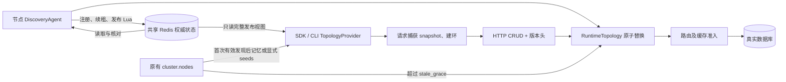

# Redis 动态服务发现与配置中心方案

> 版本：R3，2026-10-07；状态：方案已按统一路线对齐，功能及实施阶段测试尚未完成。
> 需求来源：会话 `01a11215-ae26-7d60-99de-60774f4d2510`。用户已确认 Redis 不可用时使用最近有效拓扑，超过 `stale_grace` 后回退静态配置。
> 交付范围：架构、配置和协议契约、SDK/CLI 契约、分阶段实施、TDD、验收及评审完善；不包含本次功能实现。
> 实现顺序：见 [统一实施路线](implementation-roadmap.md)。必须先通过S0五项高优修复；本文P0–P2对应S5，P3–P4对应S6，P5–P6对应S7；复用S3/S4的transport、RowCache协调器和S2的CLI包入口。

## 1. 目标、边界与现状

每个 CppPools 节点向共享 Redis 注册并续租。节点同时承担有界的拓扑发布工作；SDK、CLI 和服务端消费同一份已发布节点列表，周期更新一致性哈希环。Redis 是发现与路由参数的配置中心，业务数据、DB 凭据和 schema 不迁入 Redis。现有 `cluster.nodes` 保留为静态兜底，未启用 discovery 的配置保持现有行为。

首版只支持 Redis 7.x 或更新版本的单个权威 standalone 主节点；Redis Cluster、Sentinel 自动切主、多中心、权重、按租户动态配置和 schema 热变更留待后续单独设计。部署方提供 Redis，本服务和 CLI 不自动安装、启动、停止或清空共享 Redis。所有服务节点仍必须连接同一组真实业务数据库；独立 SQLite 文件只能验证路由，不能证明数据复制或多节点业务一致性。

| 已核对的现状 | 本方案需要的扩展 |
|---|---|
| `ClusterView`、`OwnershipRouter` 在启动时构造 | 不可变运行时拓扑，按请求持有，原子替换 |
| `nodes.empty()` 表示单节点，忽略 epoch | discovery 模式显式区分权威空、阻断、动态和静态降级 |
| `/api/v1/cluster` 从启动配置输出 | 输出正在使用的运行时视图及新鲜度，不伪装成 Redis 刚读到的视图 |
| SDK 使用 HTTP seeds，只有请求路径上的懒刷新 | 可选 Redis provider、周期刷新、关闭生命周期；seeds 模式保留 |
| SDK 的选 owner、构造 URL、发送 epoch 分别读取 `_topology` | 一次操作捕获一个 snapshot，所有尝试都使用该 snapshot |
| 配置加载要求self出现在cluster.nodes | 仅discovery开启时允许self在固定fallback列表之外，支持真正新增node_id |
| `CachingDatabase` 按借用请求 bypass，写操作始终失效 | 拓扑 admission fence、过渡清理，保留 I0 和 TTL 上界 |
| CLI 只有设计稿，尚未实现 | 本文命令是 [CLI 方案](cpl-cli-design.md) 的后续扩展，不改其本地 status/start/stop 含义 |

依据文件：`include/cpppools/config/config.h`、`src/config/config.cpp`、`include/cpppools/server/http_server.h`、`src/server/http_server.cpp`、`src/server/ownership_router.{h,cpp}`、`src/server/crud_api.{h,cpp}`、`src/db/{row_cache.h,caching_database.h}`、`sdk/python/cpppools/client.py`。

本方案是 [现有集群缓存设计](superpowers/specs/2026-08-11-cluster-cache-design.md) 的动态成员扩展：不改变 NVI 公共签名、单行 CRUD、唯一键选择、哈希黄金向量和 DB 为真理源的原则；增加控制面协调。强一致缓存、跨节点失效广播和数据库故障转移不在本版承诺内。另一个 [Redis 本地行缓存方案](redis-cache-design.md) 与本文是两个独立功能：前者是节点本地数据缓存，后者是共享发现中心。

## 2. 总体架构与不变量



不变量如下，后文的评审和验收必须逐条覆盖。

| 编号 | 必须成立的约束 |
|---|---|
| D0 | 一个 `(cluster_id,generation,epoch)` 对应唯一的路由节点、地址、lease_id 和固定路由参数；同版本不同内容拒绝 |
| D1 | 消费者只能用已发布 `nodes` 建环，不按本机时钟、自己的 HTTP 黑名单或 lease_deadline 删成员 |
| D2 | 同 generation 的 epoch 只增不减；generation 不能自动接受；注册/续租/注销均核对租约身份 |
| D3 | 业务请求和 DB 借用不访问 Redis；控制面 deadline 有界，控制线程可被停止并 join |
| D4 | 一次 CRUD 操作持有同一不可变快照；成功写入不会因随后发现新版本而重发 |
| D5 | 空拓扑不是单节点，也不是网络故障；静态回退、stale、缺失版本头和本地租约失效一律禁止缓存读及回填 |
| D6 | 切换的 fence、缓存查找和回填提交在同一准入协议内；clear 后旧请求不得回填到新视图 |
| I0 | 所有本节点写操作前后都执行原有失效，即使 bypass 或 cache.enabled=false |
| I1 | `blacklist_ttl_ms >= cache.ttl_ms`；节点 TTL 不超过中心声明的 `cache_ttl_ceiling_ms` |

节点本地缓存仍是滞后不超过源读取起点 TTL 的副本。网络分区中，静态 fallback 节点可能修改 DB，而动态 owner 尚未感知；禁止降级节点缓存并不能使健康 owner 的已有缓存立刻失效。这个窗口依旧由原有 TTL 限制；不得宣称 Redis 租约提供写 fencing、全局线性一致读或数据库互斥。需要更严格可见性时，部署选择关闭 `cache.enabled`，而不是扩大本方案承诺。

## 3. 配置契约与默认值

以下是新 `discovery` 段示例，可与现有 `server`、`datasources`、`cluster`、`cache` 段合并；不是完整 DB 配置文件。`cluster.nodes` 保留原字段。所有节点本地静态列表必须与中心 bootstrap 的 `static_fallback_nodes` 完全一致（按 node_id 排序后比较），发现成功后不一致进入 blocked，不默默使用不同兜底列表。

```json
{
  "discovery": {
    "enabled": true,
    "cluster_id": "cpppools-dev",
    "expected_generation": "7cdab506-1111-4444-8888-111122223333",
    "redis": {
      "host": "127.0.0.1",
      "port": 6379,
      "database": 0,
      "username_env": "CPPPOOLS_DISCOVERY_USER",
      "password_env": "CPPPOOLS_DISCOVERY_PASSWORD",
      "tls": false,
      "ca_file": null
    },
    "advertise_host": "127.0.0.1",
    "advertise_port": 8080,
    "heartbeat_ms": 5000,
    "lease_ms": 20000,
    "refresh_ms": 5000,
    "stale_grace_ms": 60000,
    "operation_timeout_ms": 1500,
    "startup_timeout_ms": 5000
  }
}
```

| 项 | 默认与校验 |
|---|---|
| enabled | false；false 时不加载 Redis、不开控制线程、不改变原有协议 |
| cluster_id / node_id | 1–64 字节 ASCII `[A-Za-z0-9._-]`，node_id 来自现有 cluster；启用时必须有 cluster 和非空静态 nodes |
| expected_generation | 节点必填 UUID；SDK 可首次成功读后在对象内 pin，也可显式配置 UUID；CLI 管理必须显式传入 |
| advertise_host / port | host 必填、无 scheme/path/控制字符，最多 253 字节；IPv4、DNS、IPv6 literal；port 1–65535，禁止发布 0.0.0.0、::；HTTP URL 的 IPv6 必须加方括号 |
| heartbeat_ms / lease_ms | 5000 / 20000；`lease >= 3*heartbeat + operation_timeout`，lease 5–120 秒 |
| refresh_ms | 5000，500–10000；必须 `< lease/2`；每次周期 ±10% jitter，不作为新鲜度来源 |
| stale_grace_ms | 60000，0–300000；从最近一次成功且新鲜的权威读取的请求起点计时，失败、过期读取、HTTP 成功都不能重置 |
| operation_timeout_ms | 1500，100–5000；覆盖排队、DNS、connect、AUTH、INFO、GET/TIME 或脚本、解析；不是每条命令各获得一次预算 |
| startup_timeout_ms | 5000，至少 operation_timeout；首次失败可以静态降级 ready，错误配置不允许 ready |
| Redis 与 TLS | 不把凭据放 URL、root、响应或日志；环境变量缺失/空值、CA 错误拒绝启动；tls=true 时必须验证证书和主机名 |

中心 policy 冻结 `protocol_version=1`、`hash_algorithm=murmur3_32_seed0`、`vnodes_per_node=100`、`cache_ttl_ceiling_ms`、`blacklist_ttl_ms`、`lease_ms`、`heartbeat_ms`、`refresh_ms`、`stale_grace_ms` 和静态 fallback 列表。它们在一个 generation 内不可热改；改变需要新 generation 的受控恢复。各节点本地值与 policy 不一致拒绝注册。SDK 使用中心时间参数，HTTP seeds legacy 模式继续自己的原参数。CLI `init --manifest` 的 manifest 只含 cluster_id、generation、这些 policy 字段，严格校验后写入；不含 DB 配置和密码。

discovery开启时，cluster.node_id是本节点身份，cluster.nodes仅是固定fallback列表，**不要求self出现在该列表**；关闭discovery时继续现有self成员校验。P0须调整当前配置解析顺序和头文件说明：先严格解析discovery开关，再应用对应校验。fallback `{A,B}` 下新增C，C仍配置同一 `{A,B}`，靠advertise及register加入动态members，不修改中心policy。

同时校验 `blacklist_ttl_ms >= cache_ttl_ceiling_ms`；节点应用cache有效默认值后不得超出ceiling。首版discovery.enabled=true与cache.warm_reuse=true组合明确报配置错误，多节点写入不能证明持久缓存暖资格；单节点无discovery的显式暖复用仍按缓存方案。

## 4. Redis 数据模型、发布与原子性

### 4.1 单文档权威模型

唯一业务 Key 是 `cpppools:discovery:v1:{<cluster_id>}:state`，类型 STRING，不设置 TTL。花括号为以后保持同 slot 留余地，不表示首版支持 Redis Cluster。状态包含：metadata、policy、租约 records、published snapshot、blocked_node_ids 和有界管理操作结果日志。instance_id、lease_id 是 fencing 身份，不是认证秘密；所有授权写节点是可信控制面参与者。读用户可以看到文档，但绝不能得到 Redis 凭据。

| 限制 | 值与超限行为 |
|---|---|
| 活跃节点 / 保留租约 / blocked IDs | 各最多 64；过期 records 在发布时删除，blocked 不自动解除 |
| root / published nodes | UTF-8 root 最大 128 KiB，HTTP cluster 投影最大 64 KiB |
| 管理 operation log | 最多最近 64 项，保留最多 24 小时；已被裁剪的 operation_id 返回 unknown |
| Redis 响应 | 单次包括 INFO/root/TIME 的总解析预算 256 KiB；限制 RESP 深度、数组/字符串长度，超限协议错误 |
| 数值 | 时间为 Redis TIME 的整数毫秒；epoch、revision、sequence 为 0–9007199254740991 的 JSON 整数，禁止 bool/浮点、溢出拒绝操作 |

每次变更脚本在内存读取、校验并构造整个候选文档，最后只执行一次 `SET state serialized_candidate`。没有先 INCR、先删租约、再写 snapshot 的中间状态；SET 是提交点，提交后脚本只返回已构造结果，不再执行可能失败的转换或命令。脚本执行具有原子可见性，但不能把运行错误理解为自动回滚；单次最终 SET 的选择正是为了缩小部分写入风险。[Redis Lua 执行语义](https://redis.io/docs/latest/develop/programmability/eval-intro/)、[Redis 关于无回滚的说明](https://redis.io/blog/you-dont-need-transaction-rollbacks-in-redis/)。

Redis 设 `maxmemory-policy noeviction`，预留控制面内存；禁止 FLUSHDB/FLUSHALL 和其他客户端直接改 state。持久化是恢复辅助，不是共识或零丢失保证；不能恢复备份后直接信任旧 epoch。[Redis 淘汰策略](https://redis.io/docs/latest/develop/reference/eviction/)、[持久化说明](https://redis.io/docs/latest/operate/oss_and_stack/management/persistence/)。

协议资源包含有界、schema感知的JSON codec：保留array/object类型，整数按准确十进制输出，空nodes/records/blocked_node_ids/operation_log必须输出`[]`。禁止默认Lua cjson整root roundtrip：Redis 7的内置cjson默认只有14位有效数字，不能满足本协议整数边界，也不能自动保留空数组；字符串的转义可复用已验证的scalar encoder。codec限制128KiB、最大嵌套深度8，拒绝重复字段、未知必需版本、非有限数、分数和类型错；用真实Lua roundtrip覆盖最大整数与空数组。[Redis 7 cjson源码](https://raw.githubusercontent.com/redis/redis/7.0/deps/lua/src/lua_cjson.c)。

root顶层字段冻结为 `protocol_version/cluster_id/generation/authority_run_id/revision/last_time_ms/policy/records/published/blocked_node_ids/operation_log`。numeric沿用上表；ID为string，policy/published为object，records、blocked_node_ids、operation_log为array。每record字段为 `node_id/host/port/instance_id/lease_id/deadline_ms/heartbeat_sequence`；除deadline/sequence外与published node同类型。operation log每项为 `operation_id/action/input/result/committed_at_ms`，input为严格规范操作对象，result含committed及提交identity。客户端检查published节点与records的一致性、min deadline和policy；过期records仍在旧root不算损坏，而published与同一root记录不一致是损坏。新版本扩字段必须先修订protocol和codec，不依赖忽略未知字段获得兼容。

### 4.2 公共 published 投影

```json
{
  "protocol_version": 1,
  "cluster_id": "cpppools-dev",
  "generation": "7cdab506-1111-4444-8888-111122223333",
  "epoch": 12,
  "nodes": [
    {"node_id": "node-a", "host": "127.0.0.1", "port": 8080,
     "instance_id": "83f13351-2222-4444-8888-111122223333",
     "lease_id": "98535af1-3333-4444-8888-111122223333"}
  ],
  "min_lease_deadline_ms": 1791331220000,
  "published_at_ms": 1791331200000
}
```

root 额外携带 `authority_run_id`、`revision`、`last_time_ms`、policy、records 和 operation log；records 含节点完整登记、deadline_ms、heartbeat_sequence。发布数组按 node_id 的 ASCII 字节升序、node_id 唯一；不得依赖 Lua map 遍历顺序。心跳可以更新 min deadline、发布时间和 revision，**不改变路由 epoch**；路由节点、地址、instance_id、lease_id 任何变化才使 epoch 加一。一轮脚本移除多个过期节点并添加一个节点，只发布一次、epoch 加一。未变的发布内容不建新环。

所有节点的 DiscoveryAgent 每个 heartbeat 周期调用发布脚本，串行脚本足以合并并发变化，不新增 leader、分布式锁或常驻中心 daemon。发布前统一删除 `deadline_ms <= now_ms` 的 records，然后由剩余 records 构造 nodes；读 SDK 不执行脚本，不改变成员。

空published的 `min_lease_deadline_ms=null`，非空则为所有已发布lease deadline的最小整数；published_at_ms仍为提交时间。消费者先验证authority、generation、高水位和完整性，再按nodes是否空分支：空立即成为锁存empty_topology，**不套用非空remaining公式**，不会被当作expired。init/reset的空state也按此规则。

**最后一个节点崩溃时，没有进程保证立即发布空列表。** 旧非空 published 到达 min deadline 后整份视图失去 fresh 资格；消费者不自行剔除节点建新环，转 stale/fallback。节点恢复或管理员执行 prune 才发布权威空或新成员。已发布 `nodes=[]` 是有效管理状态、一直阻止 CRUD，不因没有心跳而转 fallback。这样无需给予 SDK 写权限，也不会承诺不存在的后台自动收敛。

### 4.3 时间、新鲜度和运行实例

租约只用 [Redis TIME](https://redis.io/docs/latest/commands/time/) 判定；本地 monotonic clock 只计算 elapsed/deadline。每次 read 操作在同一个固定连接执行 `INFO server`、`GET state`、`TIME`，自动 reconnect/retry 关闭；中途断线整次失败。返回时必须满足当前 INFO 的 `run_id == root.authority_run_id`，并且符合 pinned generation/epoch。`INFO` 的 run_id 标识 Redis 服务实例。[INFO 文档](https://redis.io/docs/latest/commands/info/)。

设此次读取从本地 m0 到 m1，总耗时 d；取末尾 TIME 的 t，计算 `remaining = max(0, min_deadline-t-d)`，本地 fresh 到期为 `m1+remaining`。GET 与 TIME 之间不要求原子：TIME 在后只会保守缩短旧视图有效期。新鲜度剩余为 0 时，不重置 last_good、不宣称 fresh；消费者读取同 epoch 的更新 deadline 可以延长 fresh 期限，但仍必须每次完成整个权威读取。stale_grace 只约束失去 fresh 资格后的历史视图使用，不缩短成功读取的 fresh 期限；grace=0 仍允许 fresh Redis 路由，只是在控制故障时立即静态回退。

Redis TIME 不是单调时钟。脚本若 `now < last_time_ms` 拒绝提交，返回 clock_regression；消费者遇 TIME 比本次文档 last_time_ms 小也阻断。既有本地 deadline 不因倒拨延长。上线需要时钟监控；本版不保证识别未被采样到的短暂倒拨，不能把租约称为数据库锁。大幅前跳按到期统一发布，随后重新登记即可。

## 5. 控制面操作与节点生命周期

所有脚本输入校验 cluster_id、protocol、generation、authority_run_id、root 类型/完整性、容量、数值及命令参数。AUTH、INFO、GET、TIME、EVALSHA 和最终 SET 需要分角色 ACL：读用户只允许限定 Key 的 GET 及 INFO/TIME；节点允许该 Key 的脚本/SET；admin 还可执行 init/reset/remove/prune。由于 Redis ACL 不隔离同 Key 内的脚本动作，首版 node/admin 是可信写角色，不声称 node ACL 可阻止恶意节点调用管理动作。强制区分两者需要额外管理服务，非首版目标。

| 操作 | 前置和提交结果 | 超时或迟到处理 |
|---|---|---|
| init | root 不存在；manifest 合法；原样采用manifest预先准备的generation UUID，绑定当前 run_id；发布 epoch=0、nodes=[] | 相同 operation_id先查询已提交结果；已有state不覆盖，返回CAS conflict |
| register | 服务已listen、DB/schema初始化及同generation上线校验完成；本节点未blocked；同node_id无其他未到期lease；创建前CAS expected_revision | 新instance_id为每次进程启动UUID，新lease_id为每次登记UUID；已有相同有效身份可幂等确认，但不重新延长lease |
| renew_publish | 核对 node_id+instance_id+lease_id，未到期，sequence 严格递增；同 seq 返回原结果，不延长租期 | 低 seq、旧 lease、过期续租拒绝；超时不得推算新 deadline |
| reconcile_publish | 任一授权节点/管理员统一删除已到期 records、发布完整 nodes | 无成员变化不增加 epoch；SDK 不调用 |
| unregister | compare identity 后删除本节点，发布新 nodes | 已不属于自己的 node_id 不删除新 lease；重复注销是 no-op |
| remove | 管理 expected_generation+expected_epoch 和 expected_lease_id CAS；删除记录并把 node_id 加 blocked | 被隔离的进程不得自动重新注册；解除需 reset 新 generation，本版无 unblock |
| prune | 管理 CAS，仅剔除已到期节点；不等价于强制删除存活节点 | 相同 operation_id 原结果；不得无限 retry |
| reset | 维护窗口中对旧 generation+epoch+当前 run_id CAS，写全新 generation、epoch=0、空 records，绑定新 run_id | 更换 generation 必须重新配置并重建客户端；不原地继承旧成员 |

register 超时可能已提交：agent 同身份读回确认有效 lease 后才使用；若原 lease 已过期，须使用新 lease_id 再登记，禁止用相同旧 lease 复活。老 renew/unregister 回包按本地 agent incarnation 和 sequence 丢弃。脚本载入使用 EVALSHA；NOSCRIPT 时在同一预算内 EVAL 固定发布版本脚本，不泛化为无限重试。请求送出后不自动重发管理写；读 operation log 或 matching lease 作确认。

登记携带最近权威读取的expected_revision，所有state提交在同generation内严格递增revision。创建时CAS失败仅重新读取并在有界预算内发起新的登记尝试；已放弃/到期的lease_id不得换CAS参数复活。迟到旧register即使在新lease注销后执行，也因revision已变化被拒；仅丢弃本地旧回包不足以防止幽灵成员。

启动顺序：加载并校验本地配置 → DB/schema 初始化 → bind/listen（此时 discovery 缓存关闭）→ 有界注册/读取 → 发布 runtime view → ready。暂时网络故障或有效旧拓扑过期允许静态降级接入；Redis 权威空、拒绝登记、协议/鉴权/配置/generation 错误允许 HTTP health 供诊断，但 CRUD blocked，不能声称业务 ready。中心未知时 cold start 静态降级不可能核对中心 manifest，要求已通过部署验收核对静态列表；恢复时必须立即校验。

本节点 lease 失效后停止使用缓存；仍可作为连接同 DB 的 fallback 接入节点，不假冒 owner。agent 在控制面恢复后先 reconcile，再以新 lease_id 注册，清理缓存及旧 flight，经过 §7 的 hold-down 后才恢复缓存。

该恢复也必须覆盖Redis一直健康、agent调度暂停超过lease的情况：renew返回lease_expired/lease_missing即关闭准入、放弃旧lease，进入有界 `reconcile → 读取最新revision → 新lease登记 → 权威读取`，不能永久renew旧身份。empty/业务blocked不阻止可信agent执行恢复登记；node_blocked、duplicate_live_node、AUTH和权威错误分别处理，不能按到期重试掩盖。

停止顺序：同步关闭新的缓存准入 → 停止新 HTTP 接入 → 执行既有 drain/资源收尾 → fenced unregister → 关闭 agent/Redis transport。停止期间 agent 可以续租以帮助其他客户端观察，但 HTTP 停止接入后必然可能连接失败，SDK 仍按黑名单 fallback；不引入无法兑现的“无失败请求”保证。注销失败依赖租约到期，不延长停机无限等待；已发注销后停止续租，不能让迟到 renew 重新注册。5 秒 drain 不代表进程已完整退出；CLI 本地 stop 的既有终态协议不改变。

## 6. 运行时状态机与降级决策

本地 runtime snapshot 包含 source、identity、published nodes/ring、static fallback、last_good_start、fresh_deadline、cache_gate 和诊断信息。对外 source 为 `static_legacy`、`redis`、`last_good`、`static_fallback`、`blocked`。本地状态转换使用 monotonic clock，scheduler 卡住也必须由请求准入处检查 deadline；后台线程不是准时性前提。

| 观察 | 路由状态 | 缓存 | 后续动作 |
|---|---|---|---|
| discovery 关闭 | static_legacy，保留旧单节点/集群语义 | 按原配置 | 无 Redis 网络行为 |
| 非空合法发布视图，剩余新鲜期 >0 | redis | 仅满足 §7 时可用 | 成功读取更新 last_good_start |
| 连通失败、timeout、LOADING/BUSY/连接容量暂时不足，或合法非空视图已过期 | grace 内 last_good，否则 static_fallback | 关闭 | 有界重连，过期读取不续 grace |
| cold start 暂时故障，无 last_good | static_fallback；SDK 必须有显式 seeds | 关闭 | 首次有效发现后核对策略 |
| 新鲜权威 nodes=[] | blocked / empty_topology | 关闭 | 清除路由可用性；不选择历史或静态节点 |
| AUTH/ACL、配置不符、文档缺失/损坏/超限、epoch 回退、同版本不同路由内容、run_id/generation 不符、clock_regression | blocked / 具体原因 | 关闭 | 运维修复；不得归类为普通 outage |
| fresh 到期但还在 last_good grace | last_good，仍用原完整 nodes | 关闭 | 不按 lease 过滤成员 |
| 从静态/last_good 恢复到合法同 generation 新鲜视图 | redis（重新建环并清理） | hold-down 中关闭 | 不重放已经完成的业务写 |

last_good 的时间从最近成功读取的**请求起点**算，grace=0 表示控制面出错即静态 fallback；非空视图 fresh 消失即关闭缓存。控制读取失败时即进入 last_good、关闭缓存，即使旧 lease deadline 尚未到期；在无失败但后台延迟时，到 fresh_deadline 也关闭。

**blocked 是锁存状态**：已经观察到权威空、信任或配置错误后，后续 timeout/断网/过期读取不能解除 blocked，不能重新选用之前的 last_good/static。只接受符合当前 pin、高水位和 policy 的合法新鲜非空视图才能解除；空→非空需更高 epoch。generation/run_id 变化按维护流程重新配置，不能用普通重试解除。从未观察到 blocked 的对象才适用上表的暂时故障降级分支。

权威观察高水位独立于可用路由：完整合法的fresh/expired/empty观察都推进max_observed_epoch、该版本路由内容和已处理refresh sequence；expired不更新last_good_start，仍不得因未提交fresh视图而忽略高epoch。旧last_good只按Fallback使用，不降低高水位。观察到自身在blocked_node_ids时另外锁存self_node_blocked，优先拒绝CRUD；其他节点的fresh列表不能解除，只有新generation配置才解除。remove仍不能让未观察它的分区进程立即停写，实际停写必须配合流量隔离或停机。

静态 nodes 不参与动态 epoch 排序；静态请求版本必须显式表示 source=static_fallback，不能伪造“动态 epoch=0”。静态列表与动态列表可以不同，SDK 用静态环找首个节点后发送 Fallback，服务节点本地绕缓存执行而不再 307；无可达静态节点则 topology unavailable。last_good 同样发送 Fallback，防止新旧视图间互相重定向。HTTP 可达不会让 provider 恢复 redis source，也不会重置 grace。

SDK只配置Redis可以在Redis可用时冷启动：拿候选节点后，通过HTTP获取schema。首次合法发现时记住中心static_fallback_nodes；该对象后续Redis故障可据此回退。**新进程只有Redis地址且Redis不可达，无法凭空找到HTTP节点**；必须显式提供fallback seeds才能冷启动兜底，否则抛DiscoveryUnavailable。冷启动seeds是HTTP URL列表，没有node_id且未信任中心policy，此时不虚构哈希环/动态epoch：按给定URL顺序直接尝试schema及带X-CppPools-Fallback的CRUD，source=static_fallback；无法建立schema则启动失败。首次中心读取成功后转完整snapshot，并要求显式seeds的规范endpoint集合与中心静态fallback endpoint集合相同；generation未pin时不得假造身份头，只发送source/Fallback保证server bypass。不新增落盘节点缓存，避免把credentials/陈旧信任状态恢复为权威。

generation pin 不自动跟随变化。节点/CLI 必须显式更新 expected_generation；SDK 首次读取自动 pin 的对象出现新 generation 后 blocked，调用方根据运维发布信息重建对象。同 generation 高水位持于内存；新对象没有旧 epoch 历史，依赖 run_id/authority 绑定和管理员操作纪律，不声称跨进程无外部状态即可防住同 Redis 进程内的人工数据回滚。

## 7. 热更新路由、请求协议与缓存安全

### 7.1 哈希及请求快照

继续使用既有 Murmur3_32 seed=0、unsigned 32-bit、100 vnodes、长度前缀 UTF-8/LE32 编码和 attempt=0。路由键保持 `(datasource请求值或空字符串, table, unique_column, normalized_value)`；不得拿解析后的默认 datasource 替换省略值。INTEGER 转十进制，TEXT 保留原文；REAL/null 不成为路由键。缓存内部 resolved datasource 的用法不变。不同 instance/lease 不参与 vnode hash，只用于版本和缓存身份；替换进程仍增加 epoch。

采用 C++17 `atomic_load/atomic_store(shared_ptr<const RuntimeTopology>)`，不是要求 C++20 的 `atomic<shared_ptr>`。snapshot 内含完整 nodes、ring、OwnershipRouter 和期限。`CrudApiContext` 持有 snapshot handle，不能仅把可能销毁的 router 裸指针传入；/cluster 与 stats 也读取同一次 runtime snapshot。provider 先构造校验完的 ring，随后短临界区提交，不在锁内访问 Redis或 DB。

### 7.2 HTTP 版本契约

动态及降级 SDK 请求附以下头；保留原来的 epoch、Fallback、Rejoin 语义并按动态模式收紧。

| 头 | 契约 |
|---|---|
| X-Cluster-Id | cluster_id；动态缓存准入必须完整匹配 |
| X-Cluster-Generation | pinned generation |
| X-CppPools-Epoch | 保留现有头名；捕获 snapshot 的十进制 epoch；static_fallback 不携带动态 epoch |
| X-Cluster-Source | redis / last_good / static_fallback；legacy SDK 不发送 |
| X-CppPools-Fallback | 保留现有头名，值为1；last_good/static_fallback 必须发送，任何此头均绕缓存 |

现有 `X-CppPools-Rejoin: 1` 保留并参与缓存门控；不引入 `X-Cluster-Epoch/Fallback/Rejoin` 别名。新增身份头仍用表中 X-Cluster-Id/Generation/Source，响应 epoch 继续用 X-CppPools-Epoch，避免同义双头与冲突优先级。

响应回显服务端实际捕获版本和 source，不把客户端版本当服务端版本。动态 server 遇缺头、identity 不匹配或 client source 非 redis：校验业务 payload 后本地 bypass DB，**不发 307**，并用 `X-Cluster-Refresh: required` 提醒以后刷新；blocked server 则在业务执行前返回 503，`error.kind=empty_topology/discovery_blocked`。这样 legacy 客户端可连接新服务而不获动态缓存；identity 完整匹配、fresh 且 server 是有效成员时，才按既有 owner/307 规则路由。仅本节点不在有效成员中时也是本地 bypass，不能按“无 nodes = single”开启缓存。

307 仅限合法同视图，并且必须在业务执行前发出。SDK 自行处理 redirect，禁止 urllib 自动跨地址重放写 body；校验 Location 是捕获 snapshot 中的规范节点 URL、保留 path/请求 body，不跟随任意外部 URL。最多使用现有 attempt_max，发现循环停止或以显式 Fallback 在捕获列表中选节点；不得无限 refresh+307。跨版本响应只触发未来操作刷新，已成功的当前写只返回一次结果。

GET `/api/v1/cluster` 保留原 `self/epoch/nodes/hash/ttl/datasource_digest` 字段，hash保持原algorithm、seed、unsigned、vnodes_per_node、attempt_base，TTL保持 `ttl.cache_ttl_ms` 和 `ttl.blacklist_ttl_ms` 的原嵌套结构，增加 discovery 子对象：protocol_version、cluster_id、generation、source、reason、snapshot_age_ms、fresh_remaining_ms、stale_remaining_ms、cache_allowed、self_instance_id、self_lease_id。降级时 nodes 返回**实际选用**的 last_good 或静态列表，不能返回已失效动态列表却标 source=redis。static_fallback 的legacy epoch字段使用现有静态cluster.epoch，discovery身份标source=static_fallback且不声称是动态epoch；legacy SDK缺少新增身份头仍只能bypass。blocked 时 HTTP 503，diagnostics 不让 SDK当成功拓扑。HTTP 投影没有 authority_run_id、内部 records、operation log 或 Redis配置。

GET `/health` 保留现有路径、纯文本body和成功语义用于活性观察；只在discovery开启时新增 `X-Cluster-Business-Ready: 0|1` 和固定枚举 `X-Cluster-Reason` 响应头；不能因health 200就认为可执行CRUD，也不要求旧探针解析JSON。GET `/api/v1/stats` 增加按固定source/error.kind的计数和当前identity，不以lease UUID作指标标签，避免基数爆炸。现有实现把所有503累计到db_timeout_requests，实施时须改为仅真实DB acquire timeout累加；discovery blocked/empty的503独立计数，不虚报DB超时。epoch/generation/freshness变更不改变DB/schema HTTP契约。

Redis模式只选择支持discovery v1旁路协议的节点，包括static fallback和cold-start seeds。SDK对未验证的目标首次使用前通过HTTP cluster投影确认discovery.protocol_version、cluster_id及进程身份；已验证结果按endpoint/instance身份记忆，旧OFF或缺协议目标不发送CRUD，可尝试其他合格候选。HTTP故障不替代Redis权威观察；该probe不把单个节点503误认全局权威empty。首次迁移先关闭缓存、完成节点升级及discovery启用，再放行Redis SDK；旧owner会忽略Fallback，不能把仅发送新头当作安全保证。此能力核对沿用HTTP期限，bootstrap仍共享总预算。

### 7.3 缓存准入与切换顺序

所有数据源共享同一个私有 `CacheAdmissionGate`，其mu是本文的runtime admission锁、准入锁和提交锁，revision是唯一全局admission_revision，联合token的topology_revision就取此值；每个RowCache绑定该gate，并保留自己的shard generation。gate声明于db私有轻量头，由server持有和设置状态，不依赖server类型。请求取得cache admission token时，同时持有runtime identity和revision。cache lookup在同一mu内验证token/当前identity/fresh deadline/本节点lease，再查缓存；DB miss在锁外执行，回填提交再核验同样条件。锁只覆盖检查与内存查找/提交，不跨DB或网络；legacy未绑定gate时沿用原逻辑。

准入token通过CachingDatabase的私有per-borrow上下文传入，并与现有bypass同用RAII恢复，禁止泄漏到下次池化借用；不修改Database公共NVI。`join_flight`也是可能直接返回缓存行的路径，必须受相同准入检查；future等待在锁外，醒来后重新检查token和源读取TTL。flight结果携带源读取起点/到期时间，超期或token失效则丢弃共享行、按bypass独立回源，不能make_hit。Flight handle在join的同一shard临界区捕获唯一flight_id和shard generation；finish及异常guard只可结束自己匹配的flight，旧leader不得摘除同key的新flight。已失效leader仍可返回自己的DB结果，但不得向新flight传播。

拓扑、source、本节点 lease 或 cache eligible 状态变化时：获取提交锁 → 关闭准入并递增 revision → 原子替换 runtime → 对各数据源 clear（含现有 generation/flight retire）→ 释放锁。所有 cache lookup/refill 的锁序固定为 runtime admission 锁 → RowCache shard 锁，写失效仅拿 shard 锁，不反向获取 admission 锁。不要持有 admission 锁等待旧请求、singleflight 或 DB 连接；旧请求可完成 DB 返回，但 token 不再允许读缓存或回填。

共享gate只保护本地状态：memory查找/清理可在短锁中完成；Redis读写在后端lane内、gate之外执行，回复后再检查topology_revision/backend token才暴露缓存行。拓扑clear对Redis旋转namespace，不在gate内扫描/DEL旧空间，旧SET只能进入旧namespace。具体组合见[路线的token对齐](implementation-roadmap.md#42-rowcachetoken和锁只维护一套)。

现有handle_rejoin、cache/enable、cache/disable及内部clear全部接入同一准入/退休入口；Rejoin和真正执行的clear递增revision撤销旧token，保持既有Rejoin节流。人工enabled开关与discovery有效准入分别保存，enable不能越过blocked、租约期限或hold-down，agent恢复也不能擅自撤销人工disable。

重新启用动态缓存要求：当前 source=redis、完整 identity 匹配、本节点对应 lease 有效、无 Fallback/Rejoin、未进入黑名单恢复期、policy 校验通过，而且该完整 runtime identity 已连续 fresh 保持 `cache_ttl_ceiling_ms` 的 hold-down。任何 source/identity/lease 变化重新开始 hold-down；仅 heartbeat 改 deadline 不重置。首次启动也 hold-down，便于统一实现。期限检查和启用提交均走 admission 锁，防止计时器与请求争用。

hold-down 用来避免切换后继续携带旧 owner 的缓存，并给旧副本 TTL 自然退出；不证明分区中的所有写都已传播。当前的别名 UNIQUE 键失效限制仍在，不能因更换环宣称消除。源读取开始时间锚定现有 TTL，拒绝将旧 DB 读取结果按回填时刻重新延长生命周期。Redis 本地缓存后端若实施，也必须接收相同 admission token/fence；旧后端 namespace 的清理不能触及本中心 state Key。

## 8. Python SDK 与未来 CLI 契约

### 8.1 SDK provider 与生命周期

保留 `ClusterClient(seeds=[...], ...)` 和现有零第三方依赖行为。新增 `ClusterClient.from_redis(discovery_profile, seeds=None, ..., background_refresh=True)`，profile 含 endpoint/cluster_id/凭据环境变量名/可选 expected_generation/有界 timeout；seeds 只用作冷启动临时故障 fallback，并必须在首次中心成功时与 policy 列表核对，不能永久和中心不同。不从 HTTP seeds mode 自动升级为 Redis mode。

TopologyProvider 分 HTTPSeedProvider 和 RedisTopologyProvider，统一返回不可变 snapshot 或分类错误。Redis 可选依赖只在 from_redis 分支延迟 import；包 extra `[discovery]` 选择同时支持项目 Python 3.8 基线的 redis-py 版本，实施阶段锁定并真实安装验证，不在文档中写未经验证的“最新版兼容”。TLS、timeout 与禁止自动 retry/reconnect 需对该选定版本逐项核对；必要时用低层固定连接，不能让连接池在 INFO/GET/TIME 间换实例。

Redis模式新增 `startup_timeout_ms` 默认5000，启动预算覆盖中心读取和schema HTTP bootstrap，各子步骤消耗同一剩余budget，不能给每节点重新增加完整总期限。现有HTTP callable/urllib的逐次recv timeout不满足总期限；扩展现有transport的discovery bootstrap适配器，支持absolute monotonic deadline、有界DNS/connect/分块读取和取消，每次I/O检查剩余时间，schema body上限1MiB、cluster投影64KiB。legacy CRUD transport行为保持原样。from_redis注入的bootstrap transport必须显式声明上述deadline能力，否则启动前拒绝；不能接受普通旧callable后仍声称启动总期限有界。获取候选后遵循当前 `_fetch_schema` 和多source schema校验；节点列表本身不能代替schema。DB datasource摘要只能辅助诊断，真实连接一致性由部署验收证明。

Redis模式不继承legacy“先换topology再_fetch_schema、失败静默保留旧schema”的提交方式。同generation schema冻结，bootstrap获得不可变完整schema；后续snapshot携带并复用该schema引用，客户端状态在同一次提交中发布。新节点上线前核对完整路由相关schema/真实DB目标，不一致不得登记；实际HTTP获取到不一致schema时拒绝候选并报schema_mismatch。需要变更schema则按重启/新generation维护，不新增热schema能力。

刷新流程：singleflight获取一次provider read → 校验版本/容量/策略 → 在锁外建环 → 在提交锁核对closed=false、当前identity和refresh request sequence → 原子提交。迟到旧epoch、旧sequence及关闭后的结果不覆盖当前状态；source并非可排序版本，合法fresh读取可解除普通last_good/static，但不能解除锁存blocked；blocked解除遵循§6。管理员generation改变必须blocked。刷新错误记录原因，业务调用获取当前模式，不等待background Redis操作。新鲜度/静态转换也由请求路径检查，不能只靠后台timer。

一个 CRUD 操作捕获 snapshot 和 schema 引用，owner、候选、URL、epoch及headers都从该对象派生；重试中黑名单只改变尝试选择，不改变环成员。节点 URL 与地址一起固定，不能同一请求 owner 使用旧节点而 URL 使用新地址。HTTP 成功但版本不同只排队未来刷新；写 timeout/连接断开后的业务重试规则完全继承现有 SDK 实际行为，本扩展不把写异常称为幂等、不新增自动重放。新 provider 不修订旧 SDK retry_max/attempt_max 的含义。

固定snapshot不代表继续发送已失去资格的请求。每次实际HTTP发送前（含retry/redirect/换候选）检查closed、锁存blocked和捕获模式期限；redis检查fresh_deadline，last_good检查stale期限，static_fallback检查仍允许降级。失效就结束当前操作，不换新snapshot继续；下次调用重新捕获状态。检查和发送授权有明确本地线性化点，已经授权在途的HTTP可结束；成功写正常返回，不因close或后续视图更新重发。

新增 `close()`、上下文管理与 closed 状态。close 幂等：阻止新刷新 → 唤醒等待 → 取消/关闭由该对象创建的 Redis连接 → 最多 operation_timeout+1 秒 join；join 未完成返回明确关闭错误，不能静默漏线程。外部注入 provider/HTTP transport 的所有权由构造参数明确，本对象默认不关闭借用对象。已有进行中 HTTP CRUD 可以按既有 timeout 完成；close 后新 CRUD 抛 ClientClosed。禁止复制活跃客户端到 fork 子进程；需子进程重新构造。legacy seed 模式不开线程，close 只改变生命周期状态。

### 8.2 CLI 命令及输出

命令实现依赖 [CLI 方案](cpl-cli-design.md) 的parser/输出和SDK CRUD模块；本地生命周期不需要依赖discovery admin。CLI根级/各子parser仍 `allow_abbrev=False`。只在远程CRUD/health的命令parser新增 `--discovery-profile PATH`（写在命令名之后），与现有显式 `-u/--url` 主模式互斥；discovery模式不注入CPL_URL或默认localhost URL，profile内可含fallback seeds。help/version不读取profile、不import Redis、不联网。远程CRUD复用SDK；health仍直接HTTP探测，可借只读provider取候选，但不能为了health初始化schema。

下表 `cpl discovery` 每个叶子命令的 `--profile PATH` 必填，`-o/--output json|table` 默认table。选项固定在叶子命令后，例如 `cpl discovery route explain --profile profile.json ...`。操作timeout来自profile，可用 `--timeout-ms N` 覆盖，必须有界；不与原CRUD `-t` 的逐次HTTP timeout混同。

| 命令 | 输入与语义 |
|---|---|
| info | 只读 root/INFO/TIME，显示 identity/source/authority 是否匹配/policy/容量；blocked 也提供诊断 |
| nodes | 只读已发布完整 nodes，可 `--include-leases` 展示独立 lease diagnostics；不按 lease 过滤输出 nodes |
| watch | `--interval-ms` 默认 5000、范围500–10000，`--count N` 可限定；JSON为一行一对象；每轮有限 timeout，Ctrl+C=130，无 busy loop |
| route explain | 必填 `--table T --column C --value-json VALUE`，可 `--datasource D --attempt N`；严格值校验，显示四元组、编码、hash、owner、identity/source和 cache eligibility，不发送 CRUD |
| init | `--manifest PATH --operation-id UUID`；仅无 root 时创建；显示将创建的 policy，不隐式覆盖已有中心 |
| prune | `--expected-generation UUID --expected-epoch N --operation-id UUID`；仅剔除已到期节点 |
| remove | 在 prune 参数基础上加 `--node-id ID --expected-lease-id UUID`；隔离成员，非停止服务进程，必须另用现有本地 stop 或部署系统停机 |
| reset | `--expected-generation UUID --expected-epoch N --expected-run-id ID --manifest PATH --operation-id UUID --maintenance-ack`；manifest 含不同新 generation；维护确认是显式非交互 flag |
| operation status | `--operation-id UUID`；只读已保留结果，输出 committed/rejected/unknown；unknown 不等同于未提交 |

route explain 的 column 必须取现有唯一键规则；首次需 HTTP schema，不能只有 Redisnodes就假设列合法。value-json 只接受整数或字符串，拒绝 bool/float/null/对象。省略 datasource 编码空字符串、输出 `requested_datasource=null`，不要替换为默认 datasource；attempt 0–attempt_max-1，黄金向量以 attempt=0验收。blocked/空视图不输出虚构 owner。

**只有cpl discovery子命令**采用JSON stdout单一envelope：`{"ok":true,"data":{},"error":null}`，失败error含kind/message/exit_code/http_status/details，其中无HTTP状态时为null；logs和脱敏诊断只到stderr。parser失败仍按原argparse输出stderr/退出2。watch为每轮一个同形NDJSON envelope；轮询失败输出失败记录并继续，count包含失败轮次，count耗尽若曾失败返回3，Ctrl+C覆盖为130。table同等字段，不掩盖degraded/blocked。远程CRUD及原health/start/stop/status保持CLI原输出/错误通道，CRUD JSON不加envelope。管理超时若结果不明输出operation_id、observed_identity、`retry_safe=false`，建议operation status，不自动换operation_id再执行。

沿用CLI退出码0、2、3、4、5、6–10、130的原含义；discovery新增11=管理CAS冲突/拒绝，12=写结果不明。discovery按下表分类，先判参数、再管理提交不明/CAS、再具体读取原因；“blocked”只是状态不能覆盖具体原因的退出码。watch是诊断流，不保证每条观测是当前最新版本。

| discovery错误kind | 退出码 |
|---|---|
| usage_error/input_error（本地参数/manifest/profile） | 2，未发网络 |
| management_unknown（已发写未确认），operation_missing/expired（status查不到） | 12 |
| cas_conflict/node_blocked/duplicate_live_node/operation_id_conflict | 11，管理拒绝 |
| connection_timeout/connection_error/control_expired/empty_topology/authority_changed/generation_mismatch/epoch_rollback/policy_mismatch/clock_regression/auth_error/acl_error | 3，诊断显示blocked/degraded但不报集群可用 |
| protocol_error（坏JSON/类型/大小/同epoch不同内容），state_missing，redis_server_error（未单独归类的服务错误） | 5；同样可能锁存blocked |
| confirmed_success | 0 |

临时LOADING/BUSY映射control_expired=3；READONLY/连接到replica是policy_mismatch=3，不自动换端点。运行中SDK仍按现有TopologyError→3兼容映射，由kind细分原因；表中5主要适用于discovery诊断命令，不改变既有CRUD错误契约。info/nodes输出诊断时保持上述实际退出码；watch正常count耗尽采用之前说明的流汇总3，不用某一轮5覆盖汇总规则。

operation log 使用 UUID 幂等键绑定 action+规范输入：同 id 同输入返回原已存结果，同 id不同输入=11。CAS拒绝不修改state，返回rejected且不占用持久log；重复同id若首次CAS拒绝但后来条件满足，必须由调用方重新显式确认后用新id，不声称拒绝结果已持久化。对操作结果记录的裁剪发生在最终SET同一提交内；查不到=unknown。reset 前旧 operation记录不会默认继承到新generation，须在新root保留本次reset提交记录，便于超时查询。

## 9. 安全、性能与运维流程

### 9.1 可选依赖和线程资源

复用 Redis 本地缓存方案的 `CPPPOOLS_USE_REDIS=OFF` 可选开关；启用 discovery 而构建未带Redis时在配置阶段明确失败，不悄悄忽略。hiredis 依赖私有，不暴露到 NVI/pool public API。若两个功能都实施，提取最低限度私有 transport 至 `src/redis/`，db 和 server 各自依赖该下层设施，不能让 db 依赖server；连接、timeout、凭据、队列及实例各自独立。必须修订 CMake 源列表和库链路，默认 OFF 的全套 CTest 依旧无 Redis依赖。

控制agent只有一个串行有界队列；最多1个在途刷新/注册事务，不用HTTP worker或DB pool承担心跳。使用非阻塞transport和steady_clock总deadline；DNS需可取消/有界resolver或部署使用IP，不能宣称普通同步getaddrinfo天然受socket timeout限制。队列满合并重复刷新，管理操作明确拒绝，不无界积累。停止唤醒poll，回调捕获弱生命周期/sequence，不在销毁后写runtime。

每次root全量JSON更新O(节点数)，首版最多64节点，因此先采用容易验证的单文档协议。最大规模心跳写流量、Lua阻塞时长和解析成本纳入P6压测；若p99脚本超过5ms或控制面操作超1500ms预算，先缩小部署容量再演进模型，不先引入多key/leader复杂度。脚本执行期间Redis阻塞其他活动，因此上限必须真实测量，[官方脚本说明](https://redis.io/docs/latest/develop/programmability/eval-intro/)。

### 9.2 初始化、扩缩容与故障恢复

1. **新建中心**：部署独立Redis与ACL/TLS/noeviction/持久化；准备不含secret的manifest及generation；CLI init；各节点配置相同policy/static nodes/expected generation，启动注册；SDK Redisprofile读取并获取schema。
2. **加节点**：新node_id、相同DB与schema、可达advertise地址；完成listen后注册；一次epoch发布；SDK周期读；新节点及更新视图节点hold-down；数据库不迁移，只有缓存冷启动。
3. **减节点**：正常stop经drain后unregister；突发退出由其他agent到期剔除；最后一个崩溃按§4.2处理。计划隔离用remove+另行停机，避免自动重登记。
4. **短暂Redis网络故障**：各对象last_good、缓存关闭；grace后静态；Redis原run_id与generation恢复且新视图合法后自动回redis，缓存重新hold-down；观察DB负载。
5. **Redis重启、备份恢复、手工删除root、epoch异常或需要改policy**：视为不可信恢复，不自动继续原generation。进入维护，停止业务流量和旧注册agent，核验新run_id/存储/manifest/真实DB；使用reset（missing root用init）创建新generation和空成员；分发新generation与policy，节点重新注册、客户端重建并校验schema，恢复业务。root损坏/错误Redis类型导致无法读取CAS身份时，操作员在上述停流停agent后保存损坏证据，核对精确cluster_id/Key和实例，用运维管理凭据只DEL该单Key，再init全新generation；这是明确的灾难恢复步骤，不向日常CLI开放force覆盖。可用性需要停机窗口，本版不支持透明HA恢复。
6. **rollback功能部署**：先冻结业务、关闭cache，恢复原静态配置和legacy SDK，核对列表/DB后重启；禁止混用旧generation视图继续声称动态fresh。删除state非日常回滚步骤。

run_id绑定防止通常的进程重启/备份恢复误认旧权威；授权管理员在同一Redis进程直接改Key、通过DEBUG等手工回滚不是可自动判定场景，必须遵守维护流程。CLI reset在新run_id与旧anchor不符时仍能以显式expected-run-id+旧generation/epoch执行管理CAS；普通register/renew/read禁止绕过。`maintenance-ack`不是安全锁，真正停流由部署负责人执行并留证据。

## 10. 文件划分与分阶段实施

以下为计划文件或明确修改点，不表示现在已创建实现文件。每阶段按 RED（失败行为测试）→ GREEN（最小实现）→ REFACTOR（减少重复且保持行为）→ reviewer复核执行；进入下一阶段前提交真实测试命令、非零用例计数、平台、skip和失败日志。不得把本次文档评审当作实施阶段通过。

| 模块 | 计划路径与职责 |
|---|---|
| 配置 | `include/cpppools/config/config.h`、`src/config/config.cpp`：discovery解析、策略校验、secret环境读取 |
| 可选transport | `src/redis/redis_transport.{h,cpp}`：私有hiredis、固定连接、总deadline、reply cap；与本地缓存设计协调 |
| 控制面 | `src/server/discovery_protocol.{h,cpp}`、`discovery_agent.{h,cpp}`、`discovery_scripts.h`：模型、脚本、生命周期 |
| 运行时 | `src/server/runtime_topology.{h,cpp}`、现有 ownership_router/http_server/crud_api：快照、路由、动态HTTP响应 |
| 缓存 | `src/db/cache_admission.h`、现有row_cache.h/caching_database.h：私有共享gate/fence/token与flight metadata；不暴露server类型 |
| SDK | `sdk/python/cpppools/topology.py`、`redis_discovery.py`、现有client.py：provider、身份、close、schemabootstrap |
| CLI | CLI方案模块及 `sdk/python/cpppools/discovery_cli.py`：只读/管理命令；与CRUD共用provider |
| 测试 | `test/test_discovery_protocol.cpp`、`test/test_runtime_topology.cpp`、`test/test_discovery_agent.cpp`；SDK的 `test_redis_discovery.py`、`test_discovery_cli.py`、`test_discovery_e2e.py` |
| 安装文档 | CMakeLists、未来Python pyproject/extra、manifest示例和运维手册；脚本作为单一版本资源打包给C++/Python |

Lua协议资源建议唯一维护在 `resources/discovery/v1/`，CMake构建生成C++嵌入，Python包复制同一文件，校验版本和内容摘要，避免两份脚本手工漂移。Python CLI的管理脚本不能另写行为不同的一套。项目尚未有SDK打包元数据，P5与CLI打包阶段协调，不假设已有pip extra入口。

### P0：协议和配置冻结

**依赖**：本文批准实施；先不接Redis网络。

**RED**：D01测试非法配置/secret缺失、manifest generation原样采用；D02测试同版本不同nodes、generation/epoch回退、空数组/null deadline/53bit整数roundtrip；D03复用全部现有哈希黄金向量及省略datasource/IPv6。

**GREEN**：配置模型、不可变snapshot数据类型、统一错误分类、manifest/root schema与容量检查，固定HTTP字段及资源版本。

**REFACTOR/评审**：只保留被调用的类型，不建空壳agent；核对依赖方向、legacy缺省路径和numeric边界。

**验收**：默认OFF构建和原有配置全通过；enabled而未构建Redis明确失败；同identity同ring；协议示例可被双方严格解析。P0不声明动态路由可用。

### P1：控制面单文档与真实Redis脚本

**依赖**：P0；选定hiredis/Redis版本、固定连接transport先实现有界操作。

**RED**：D04并发register只保留唯一有效node_id；D05旧lease续租/注销/迟到回包拒绝；D06续租不变epoch、到期批量发布只加一次、空投影有null deadline；D07脚本校验失败/OOM/SET失败前旧root保持；D08run_id变化、时钟回退、sameepoch不同内容及epoch上限/整数精确性/空array的真实Luacodec测试；D09管理CAS/重复opid/timeout确认。

**GREEN**：实现init/register/renew/reconcile/unregister与管理脚本、reply上限、noeviction检查和协议投影；一个最终SET提交。读SDK权限真实不能SET/EVAL；写角色信任边界写明。

**REFACTOR/评审**：检查所有脚本SET前校验完整，SET后无危险步骤；所有客户端使用同资源；epoch与revision职责不同。

**验收**：真实Redis隔离Key上验证原子发布/拒绝续租/脚本OOM/跨进程并发和timeout不明；root/record/oplog上限均有边界用例。fake不能替代Lua语义证据；不要求缓存/CLI先存在。

### P2：服务端agent及运行时快照

**依赖**：P1；只服务端动态发现，缓存默认保持关闭。

**RED**：D10fresh→last_good→static及恢复时钟，grace=0健康fresh/第一次故障立即静态；D11权威空不会single/兜底，空后断网仍blocked；D12run_id/auth/坏root进入blocked、后续临时故障不解锁，503不计DB超时；D13两个更新乱序不覆盖；D14listen注册/重复node/stop超时/回调销毁竞态。

**GREEN**：agent、原子shared_ptr runtime、请求context持有快照、动态HTTPcluster/health/stats、总deadline/可停止控制线程；freshness检查放请求准入。

**REFACTOR/评审**：HTTP线程无Redis/DB心跳、snapshot寿命、停机锁序；不以std::atomic<shared_ptr>破坏C++17。

**验收**：真实服务节点注册及周期变环，HTTP cluster反映实际source；Redis断网/LOADING/重启分类正确；scheduler暂停仍不使用过期缓存；完全drain后注销，不等同5秒内必退出。P2不启用动态缓存。

### P3：动态路由与缓存fence

**依赖**：P2；服务节点仍连同一真实DB。

**RED**：D15旧读在clear前/后开始、在新snapshot后回填均受fence限制；D16新请求与clear交错不读旧entry，join二次命中/waiter token及TTL重新核验、旧leader/异常guard不结束新flight、所有waiters不死锁；D17动态缺头/mismatch/fallback绕缓存，blocked不触DB；D18hold-down、I0/I1、TTL读起点、别名边界；D19跨source/lease换代/epoch mismatch和307循环。

**GREEN**：cache admission token/锁序、请求身份头、按source选择路由、hold-down、响应refresh提示；保留所有本地写失效。

**REFACTOR/评审**：同一锁保护fence与cache操作，DB执行不持锁，旧router仍存活但失去准入；不让fence共享server私有类型到db。

**验收**：可控屏障多线程交错D15/D16必测；ThreadSanitizer在受支持平台记录结果；缓存关闭路径与legacy路由回归；分区中的TTL弱一致界限单独验收，不写线性一致断言。动态模式启用缓存需要P3证据。

### P4：SDK Redis provider与生命周期

**依赖**：P2/P3 HTTP协议冻结；可先做P2的cache-off集成。

**RED**：D20Redis-only bootstrap仍获取schema，故障coldstart无seed失败、seed直接bypass模式；慢滴schema、慢DNS、多候选共享startup budget和不支持deadline的注入拒绝；D21一个请求选owner/URL/headers不混snapshot；D22刷新singleflight、迟到响应、高水位/同epoch同路由、新generationblocked；D23成功写epoch变化只执行一次、307URL白名单/循环有界；D24close并发/关闭后迟到提交/fork/借用资源、Python3.8+可选依赖无网络help。

**GREEN**：两个provider、from_redis、后台和懒检查、schema预算、不可变snapshot、close/上下文、future refresh；legacy imports不依赖redis-py。

**REFACTOR/评审**：所有发送路径显式传snapshot，URLIPv6编码一致，第三方默认retry与连接池隔离被关掉，异常类不改变旧SDK语义。

**验收**：真实Redis+真实HTTP节点的增减/断网/fallback/恢复；旧SDK测试全部通过；无redis包环境seed CRUD成功且from_redis报可理解缺依赖；thread数量在close后归零；成功写只一次须真实请求计数。

### P5：CLI与打包

**依赖**：P1管理协议、P4provider；CLI设计的parser/输出/CRUD基础完成；其本地生命周期可独立推进。

**RED**：D25命令/flags/--url与profile互斥/CPL_URL不注入/唯一错误kind及退出码2、3、5、11、12/NDJSON/envelope仅discovery；D26管理unknown→status确认、reset保留本次记录、CAS冲突不重试；D27route explain黄金向量、HTTPschema、无CRUD；D28wheel/sdist资源一致及Python3.8 extra兼容。

**GREEN**：discovery命令、脱敏profile、严格manifest、全局选项、共享provider/脚本、可安装extra。管理命令非交互、明确maintenance ack。

**REFACTOR/评审**：不占用现有本地status/start/stop，不重新实现routing、SDKretry或健康schemabootstrap；解析、table、JSON契约一致。

**验收**：源码树外安装wheel和sdist，cpl/-m入口相同；help/version不联网；断网CLI退出码正确；管理timeout不自动重发；watch可停止且关闭provider；Linux/macOS/Windows smoke和秘密不出现在stdout/stderr。

### P6：整体故障演练、容量与交付

**依赖**：P0–P5；生产等价共享DB/受控Redis环境。

**RED**：D29至少3节点扩容/缩容/重复身份/kill末节点/缓存换代；D30短故障、超过grace、权威空、协议坏、Redis重启/恢复旧备份及另一操作员执行损坏root定点恢复；D31双侧网络分区期间写和TTL可见界限；D32最大64节点/128KiBroot/慢DNS/慢Redis/queue压力与优雅停机。

**GREEN**：只修演练发现缺口，补部署manifest/runbook/容量限制/日志和指标；不以发布压力扩大支持范围。

**REFACTOR/整体评审**：按D0–D6/I0/I1逐条核对，复查P0–P5的证据和skip，复核维护恢复步骤可被另一操作员执行。

**发布验收**：所有必测用例非零且无未批准skip；默认OFF和ON都构建测试；成功写不被扩展重发，blocked不触DB、fallback不缓存、旧读不回填；权威空和最后节点崩溃两种行为区分；无secret泄露/线程泄露/无界等待；有真实容量p99与DB降级负载数据。未达到者不得标记首版可用。

## 11. 测试证据入口与矩阵

下面是实施后命令入口，**本次只做文档核验，没有执行这些尚未存在的新测试**。首次RED新增测试必须注册进CTest/unittest发现，检查实际测试数量>0；只输出OK且0tests不算GREEN。默认配置原回归同样必须留证据。

```text
cmake -S . -B build-static -DCPPPOOLS_USE_REDIS=OFF
cmake --build build-static --parallel
ctest --test-dir build-static --output-on-failure
cmake -S . -B build-discovery -DCPPPOOLS_USE_REDIS=ON
cmake --build build-discovery --parallel
ctest --test-dir build-discovery --output-on-failure
python -m unittest discover -s sdk/python/tests
python -m unittest discover -s sdk/python/tests -p test_redis_discovery.py
python -m unittest discover -s sdk/python/tests -p test_discovery_cli.py
```

Windows多配置生成器增加 `cmake --build ... --config RelWithDebInfo` 与 `ctest ... -C RelWithDebInfo`。P1/P6真Redis与E2E分别显式设 `CPPPOOLS_DISCOVERY_REDIS_HOST/PORT` 和 `CPPPOOLS_DISCOVERY_RUN_E2E=1`；服务路径 `CPPPOOLS_TEST_SERVER` 使用真实构建binary绝对路径。启动fixture用独立prefix/cluster_id和自己核验的进程身份，不用FLUSHDB，不停止别人的Redis。每次测试终止自己创建的服务子进程并close SDK；清理Key只限自己隔离cluster_id且先核对归属。

| 层 | 必须证明 | 不能替代的证据 |
|---|---|---|
| unit | 版本/配置/时间、快照、路由、fence屏障、CLI类型 | fake Redis不能证明Lua与ACL；时间测试用注入clock不sleep一分钟 |
| Redis集成 | 最终SET原子、真并发/真实ACL/OOM/NOSCRIPT/run_id | 本地JSON赋值不算Redis通过 |
| HTTP/SDK | snapshot身份、schema、成功写一次、307循环、deadline | 请求stub不替代真实服务计数 |
| 故障演练 | outage/expired/empty/blocked/恢复/分区区别 | HTTP节点可达不替代Redisfresh证据 |
| 包与平台 | OFF/ON、C++17、Python3.8、wheel/sdist、三平台停止 | 源码导入不替代安装；某平台通过不代表三平台通过 |

每份阶段证据记录 commit/worktree、配置与policy摘要、Redis/hiredis/Python版本、真实二进制、命令、退出码、tests/skip数量、关键并发时间线和性能值。安全门槛D15/D16/D23/D30不得仅靠随机压力测试；使用barrier/fault injection命中明确交错。Redis重启试验要真正观察run_id变更，旧备份恢复不能只改epoch字段模拟。

## 12. 整体与逐阶段评审记录

### 12.1 已吸收的原会话预评审

| 发现 | 本文修订 | 对应验收 |
|---|---|---|
| 按各自租约过滤会产生同epoch不同环 | 完整published snapshot；过期整份降级而不删成员 | D0/D1、D06/D10 |
| Redis epoch不能防恢复回退 | generation pin、单authority run_id绑定、维护reset | D02/D08/D30 |
| 重复node_id和旧进程删除新登记 | instance_id+lease_id+sequence、compare注销 | D04/D05/D14 |
| clear后旧flight仍能回填 | admission锁/revision/token、先关闭再切换清理 | D15/D16 |
| 后台更新让owner/URL/epoch混版本 | 一次CRUD捕获snapshot贯穿所有尝试 | D21/D22 |
| Redis-only被误解为无需HTTPschema | 明确schemabootstrap和无seed冷启动失败 | D20 |
| CLI另写路由和未知管理结果重发 | 共享provider/scripts、CAS与operation查询 | D25–D28 |
| SDK可选依赖、线程关闭未定义 | extra延迟import、close/join/所有权与fork规则 | D24/D28 |

### 12.2 本轮作者逐阶段检查

| 阶段 | 检查问题 | 已落入正文的完善 |
|---|---|---|
| P0 | 是否错误更换旧hash/datasource或凭据进入root | 固定黄金向量、请求datasource空字符串、secret只在环境、generation与codec边界 |
| P1 | 多Key部分更新、Lua失败回滚假设、SDK读角色写权限、Lua数值/空array损坏 | 单root最终SET、只读消费者、可信写角色边界、有界schema codec与真实Lua roundtrip |
| P2 | 最后节点死后谁发布空、grace=0、空deadline、计时器挂起、shutdown迟到、损坏root无恢复 | 整份视图过期后降级、空/null独立分支、锁存blocked、请求deadline、回调incarnation、定点恢复runbook |
| P3 | clear与回填及singleflight锁序、分区写一致性被夸大 | 共享gate/token/flight_id、hold-down、I0保留、TTL残余明示 |
| P4 | Redisonly冷启动seeds与schema、总启动期限、成功写重发、run_id跨连接、close迟到提交 | 显式fallback URL bypass、deadline适配器及transport限制、成功写只未来刷新、固定连接、closed提交检查 |
| P5 | 不存在的CLI基础、旧URL选项与envelope冲突、退出码重叠、operation查询丢失 | 显式阶段依赖、-u/profile互斥、错误kind优先级、新增11/12、unknown及reset本次日志 |
| P6 | fake替代真实故障、默认构建依赖、容量无实测 | 真Redis/DB/进程及包平台矩阵，损坏root恢复演练，性能阈值为待验证门槛 |

### 12.3 独立评审与最终核验

**R2轮结论（历史记录）**：三个fresh reader分别检查控制面与恢复、服务端路由及缓存并发、SDK/CLI及分阶段交付，关闭了下表当轮发现。本轮进一步对照源码和其他方案，补充§12.4中的实际实施冲突；最终实施顺序按统一路线，而不是把R2结论当作功能通过证据。

| 评审视角 | 重点结论与本轮修订 | 状态 |
|---|---|---|
| 控制面、Lua与恢复 | 闭合grace=0健康读取、空published/null deadline、init采用manifest generation、53bit精确编码/空数组、blocked锁存和损坏root停流定点恢复；真实Redis与值边界证据仍留给P0/P1/P6 | 通过，无遗留P1/P2 |
| 路由与缓存安全 | 保留旧X-CppPools头、`/cluster`的self/hash/ttl结构和`/health`纯文本；新增共享CacheAdmissionGate及二次命中/waiter TTL复核/flight_id；discovery 503独立于DB超时指标 | 通过，无遗留P1/P2 |
| SDK、CLI与阶段交付 | 冻结`-u/--url`与profile互斥、CPL_URL隔离、discovery JSON作用域和错误码映射；加入HTTP总deadline、慢DNS/慢滴验收、closed后禁止迟到提交；P0–P6无阶段依赖循环 | 通过，无遗留P1/P2 |

**本次文档核验**：两个JSON示例均通过PowerShell JSON解析；8个Markdown fence成对；D01–D32编号齐全；所有相对docs链接可解析。此核验不运行C++/Python产品测试、不执行尚不存在的Redis discovery功能，也不作为任何P阶段GREEN证据。Redis Lua/时间/淘汰/持久化的协议依据链接到Redis官方文档及官方Redis 7 Lua cjson源码。

### 12.4 R3实施对齐与有实际影响的问题

| 问题 | 修订和阶段归属 |
|---|---|
| 固定fallback与原self成员校验使新ID无法扩容 | discovery条件校验允许self在fallback外；P0/D01、P6/D29验收 `{A,B}` 下C加入 |
| 迟到register可在后继lease删除后造幽灵成员；调度暂停后反复renew过期身份 | register expected_revision CAS；lease_expired/missing走恢复状态机；P1/D05、P2/D14 |
| expired高epoch未必推进观察高水位，自身blocked可被其他fresh成员误解除 | 观察与last_good独立；self_node_blocked单独锁存；P2/D13、P4/D22 |
| 旧OFF owner忽略Fallback，重试在blocked/close后仍可能再发 | v1节点能力/升级门槛、逐次发送准入；P4/D20、D23、D24及P6/D30 |
| 手工enable/Rejoin绕过统一gate，Redis GET在全局gate中阻塞 | 共用退休入口、人工开关独立、Redis lane在gate外、clear旋转namespace；P3/D16、D18 |
| 新环/旧schema可混用，动态多写入者不满足暖复用前提 | 冻结schema并原子发布引用；动态模式warm_reuse=false；P0/D01、P4/D21、P6/D31 |

这些修订收敛到已有阶段，不额外立独立功能。R3已知边界仍是TTL弱一致、外部提供单权威Redis及维护窗口恢复；不把分区立即停写或透明HA当作缺陷追求。
